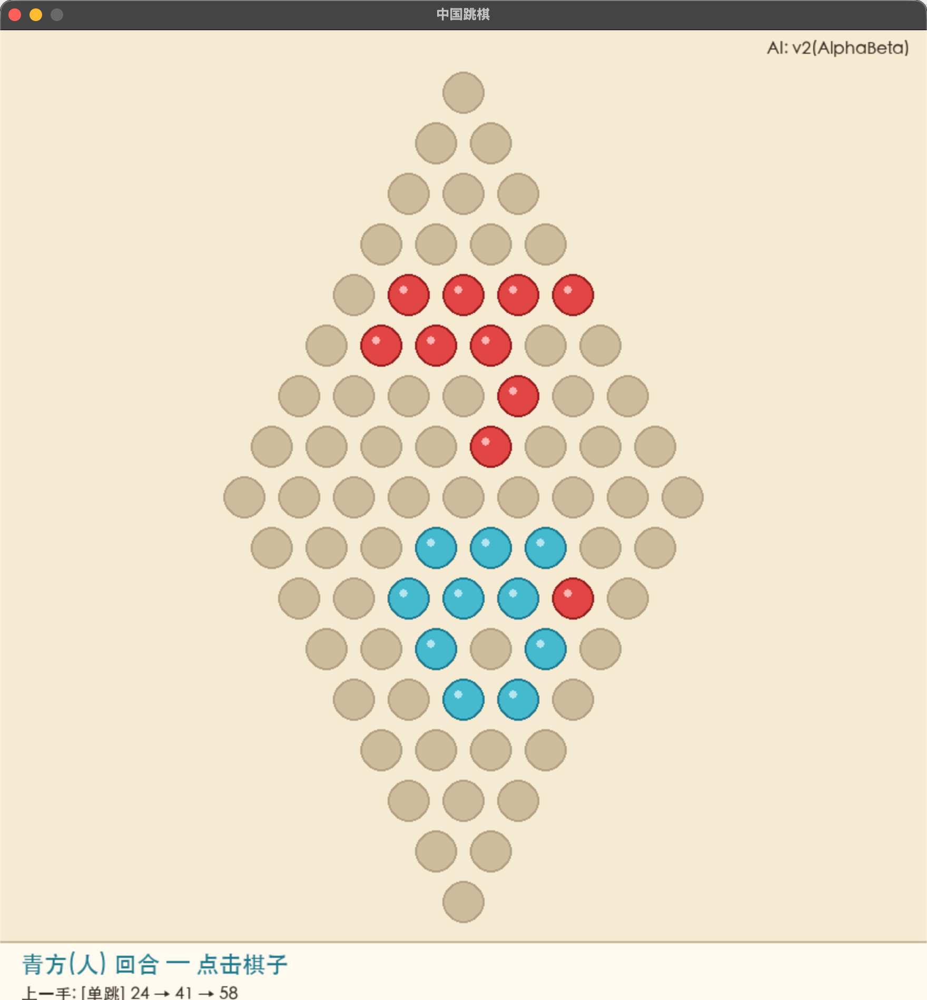
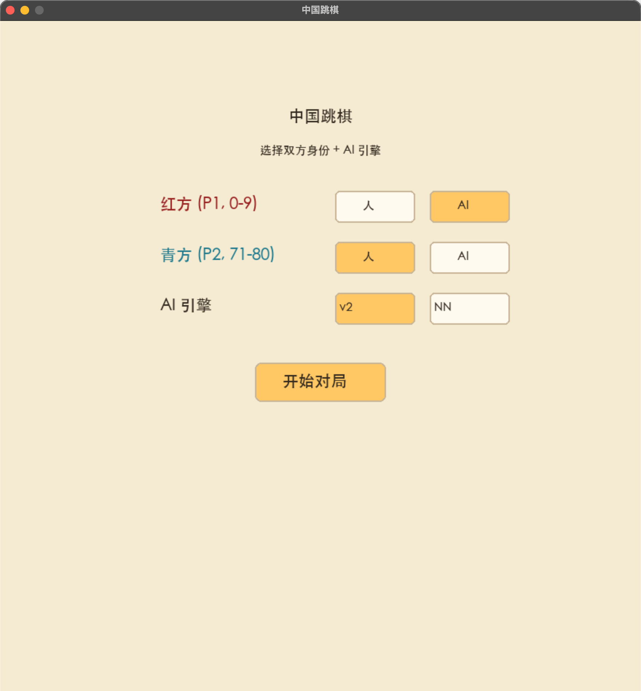

# 中国跳棋 AI（Chinese Checkers AI）

从零手写、不依赖 AI 框架的中国跳棋 AI：从棋盘规则、搜索与启发式评估，到行为克隆（BC）与 AlphaZero 风格 MCTS 自对弈的深度学习，全链路手写实现。

## 界面





## 功能与 AI 强度

- 支持 人 vs 人 / 人 vs AI / AI vs AI（GUI 或终端）
- 启发式引擎 v2（迭代加深 Alpha-Beta 搜索）：可稳定战胜普通玩家
- 神经网络（纯 NumPy 手写 CNN，policy + value 双头）：行为克隆自 V2 棋谱，训练量有限，仍在迭代中

## 技术栈

- Python 3.9
- 手写 NumPy CNN（卷积、反向传播、Adam 均自行实现，无框架）
- Minimax → Alpha-Beta → 迭代加深搜索
- MCTS（PUCT）自对弈，AlphaZero 训练循环
- pygame（仅 GUI 依赖）

## 快速开始

```bash
pip3 install pygame        # 仅 GUI 需要

python3 gui.py             # 图形界面（人 vs AI / AI vs AI）
python3 play_vs_ai.py      # 终端人机对战
python3 test_logic.py      # 核心逻辑回归测试（20 个随机种子 × 500 步）
```

## 对战结果

- 启发式 v2 vs 基线 v0：**10:0**（平均 80 步）
- 神经网络（行为克隆）vs v0：10:0 — 更换探索数据后 0:10（数据质量决定模型上限）
- AlphaZero 自对弈 vs v0：与行为克隆持平，尚未超越
- vs 外部 C++ 引擎 [clysto/chinese-checkers](https://github.com/clysto/chinese-checkers)：0:10（搜索深度差距：5s/4 层 vs 1s/十几层）

## 项目结构

```text
Chinese_Checker.py       规则核心：棋盘表示、单步/单跳/连跳生成、落子、胜负判定
engine.py                搜索引擎（Random→Greedy→Minimax→Alpha-Beta→迭代加深）+ 评估函数 v0~v7
alphazero_nn.py          手写 numpy CNN + MCTS(PUCT) + 行为克隆/AlphaZero 两种训练循环
arena.py                 对战擂台：两引擎互战、胜率/差距统计、棋子守恒校验
arena_vs_clysto.py       与外部 C++ 引擎桥接（坐标同构验证 + CLI 子进程通信）
gui.py                   图形界面（pygame）
play_vs_ai.py / play_turn.py   终端交互 / 命令行逐手对战
test_logic.py            核心逻辑回归测试
self_play_v2.py          用 v2 引擎自对弈产出训练棋谱（含视角交换增强）
gen_argmax_data.py       生成近最优(argmax)走法数据
merge_replay.py / eval_ckpts.py / evaluate_nn_vs_opponent.py
                         数据合并 / 批量评估挑选最佳模型 / 指定模型评测
```

## 学习路线

棋盘规则（图论邻接表 + 斜坐标几何）→ 搜索（Minimax → Alpha-Beta → 迭代加深）→ 评估函数（min×100+sum 基线，逐特征 AB 测试）→ 手写 CNN 前向/反向传播 → 行为克隆 → MCTS 自对弈（AlphaZero 式）。

## 说明

- `arena_vs_clysto.py` 需要自行编译外部引擎，可选，不配置不影响其他功能
- 模型参数（`.pkl`）与训练棋谱不大入库，请自行训练或联系作者获取

License: MIT