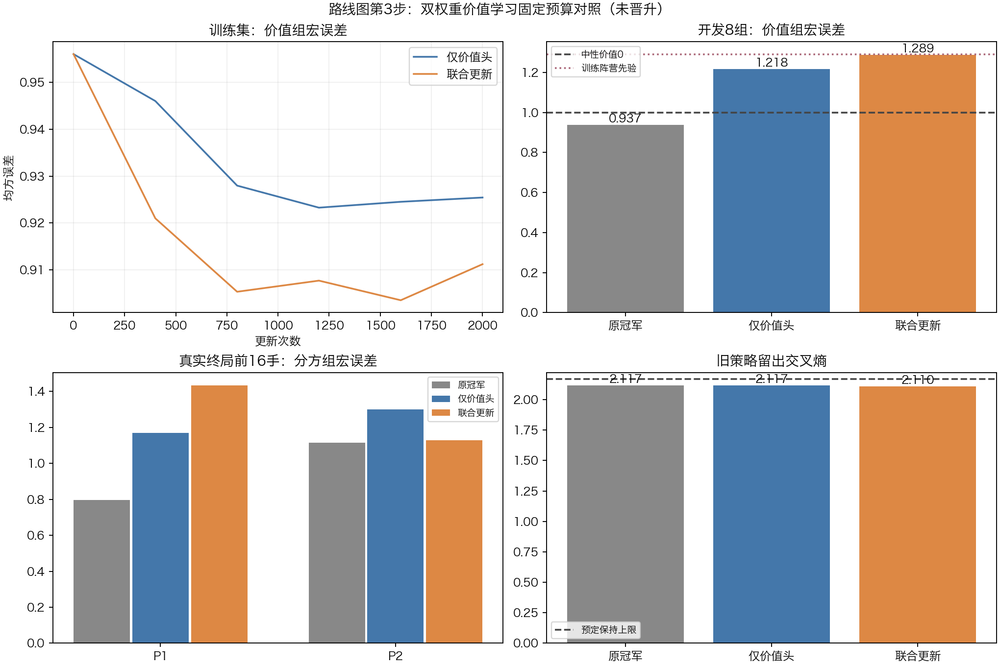

# 路线图第3步：双权重价值训练对照

**结论：两组均未达标，保留原冠军；下一步先处理价值训练的有效目标分布。** 固定试验已结束，共252.5秒，没有启动新的训练或对局。

## 实际做了什么

1. 新增独立policy_weight/value_weight读取和损失；历史排除的样本不能重新进入训练，开发探针按split隔离。真实规则和棋价值0、权重1；未完成限步局及未落子的策略探针不提供价值标签。
2. 同一v3、同一固定数据、同一逐步抽样序列，分别训练仅价值头与联合更新两组，各2000次。训练16开局组/32局，开发8组/16局。价值池2471/1218条，策略池1267/624条。
3. 过程只看训练指标，原v3与两个固定终点各做一次开发评测。全部验收门槛在训练前固定，无通过候选即停止该配置。
4. 三个子代理分别独立检查训练工件、抽样与标签、已保存预测及门槛；保留原模型、6个阶段检查点、执行源码快照、完整抽样轨迹和中文日志。

## 对照结果

价值主指标先对每个开局组的有效局面求平均，再对组等权平均，越低越好。不能把1218个相邻局面当作1218场独立比赛。

|指标|原v3|仅价值头|联合更新|
|---|---:|---:|---:|
|训练组宏价值MSE|0.9561|0.9254|0.9112|
|开发组宏价值MSE|**0.9374**|1.2181|1.2886|
|开发末16手P1组宏MSE|**0.7978**|1.1706|1.4341|
|开发末16手P2组宏MSE|**1.1141**|1.3005|1.1278|
|新开发专家走法首选命中率|33.33%|33.33%|**39.58%**|
|新开发策略交叉熵|2.2816|2.2816|**2.1816**|
|旧策略留出交叉熵|2.1170|2.1170|2.1102|
|旧价值留出MSE|1.0095|1.0015|0.9858|
|普通留出策略交叉熵|2.3979|2.3979|2.3029|
|全部预定门槛|基线|未通过|未通过|

开发中性价值0的组宏MSE为1.0000，训练阵营先验为1.2911。两候选都没有超过中性价值0，且**8/8开发组全部退步**。两候选的旧能力三项及新策略CE保持门槛均通过，失败集中在价值信息增益和末段双方价值。联合训练学会了更多专家动作，但新价值预测变差，当前不进入第4步NN+MCTS或第5步整局晋升。

## 查到的具体原因

### 1．训练后的有效价值目标偏向阵营先验

数据保持自然结果：训练P1胜12局/P2胜18局/真和2局；开发P1胜15局/P2胜1局。按开局组均匀抽样后，进入优化器的目标分布又发生了变化。

|统计范围|P1平均真实z|P2平均真实z|
|---|---:|---:|
|训练全池按局面平均|−0.1480|+0.1588|
|实际32000次价值抽样|**−0.1975**|**+0.1822**|
|开发真实目标|**+0.8831**|**−0.8804**|
|仅价值头开发预测均值|−0.2050|+0.0102|
|联合更新开发预测均值|−0.2532|+0.0367|

仅价值头的P1输出−0.2050接近实际训练抽样目标−0.1975，而开发P1真实目标为+0.8831。模型在学习训练集的阵营胜率，跨到胜负比例相反的开发集就失败了。

末段前8条与全程后8条抽样的P1目标分别−0.1964/−0.1985，方向几乎一致。因此不能只怪末段过采样，按组均匀也改变了有效目标先验。完整抽样计数见sampling_audit_review。

### 2．同一阵营内部仍然分不清好坏局面

原v3开发总体相关系数+0.486，分开P1/P2后仅−0.012/+0.033。联合更新后总体相关−0.869，但分方仍仅−0.007/+0.038。总体相关主要受两阵营输出差异影响；本轮没有学到足够的阵营内部局面区分能力。

联合训练的开发P1输出标准差只有0.0203，P2为0.0263，进一步表现为输出集中在各自的阵营倾向附近。原v3在这批开发上的0.937也不能解释为已有稳定的局面判断能力。

### 3．继续加训练步数不是当前下一步

联合训练的训练误差确实下降，新开发专家动作命中也提升6.25个百分点，说明数据可以推动参数更新。价值却在所有开发组恶化；先修正训练覆盖与有效目标，再投入更多训练。

本轮两组的可训练参数范围和损失项同时不同，不能把差异单独归因于是否解冻CNN。

## 训练与评测工程审计

- 2000步抽样由独立程序重建，全部一致。两组序列SHA相同：8f6bc93f71ec1c78a9a069f784715b7615c9b00e0d9519b4d066702fbf8d2c63。
- 全部64000次新样本抽取仅来自训练；无开发probe混入，无被排除mask复活，旧KL索引仅来自旧训练池。
- 价值覆盖2462/2471个有效样本ID，策略1267/1267，末16手489/489。价值同批重复175次、策略198次，均记录；有放回抽样没有伪装成更多独立对局。
- 仅价值头0/1000/2000步的全部非value参数和位置buffer逐值不变。原v3与冠军注册表SHA不变。
- 原评测的策略logits SHA出现差异：基线参数全冻结，重新加载候选默认可求梯度，触发不同浮点计算路径。合成输入在相同requires_grad状态下全部logits严格相同；混合状态下batch32最大差约3.8e−6，首选相同。**原门槛false与原结果原样保留。** 该组另有多项独立价值失败，不影响未晋升结论。
- 执行后修正policy_metrics：统一冻结计算指纹，再恢复原模式和梯度标志；新增回归测试。executed_source保存实际执行的旧源码，根目录是修复后源码；没有重新训练或回改开发分数。

原执行176项本机测试通过；干净检出重建后176项完成，4项可选依赖跳过，其余通过。指纹修复后本机177项通过；最终干净检出结果见validation.json。没有修改C内核或规则。

## 下一步具体做什么

仍在路线图第3步处理价值学习，暂不开展第4步搜索升级：

1. 对现有训练棋谱按**收集前即可观察的棋形特征**拆分：双方出营数量、目标剩余距离、根进度差和阶段；核对每层的胜负与有效抽样目标。先找到哪些训练层缺少胜局或败局。
2. 在生成前固定上述棋形分层、新开局seed和有限采集预算，补充独立真实对局；按根局面分组隔离历史、训练、开发，保留strict固定P1先手和身份平面。不能按新开发赢家事后重分或挑局。
3. 只在训练集内预定组/阶段/结果权重，同时明确报告采样后P1/P2目标均值；先做一个固定CNN价值对照，保留原策略能力约束。新数据是否覆盖足够由预先门槛决定，未达到就报告数据不足。
4. 在**全新的固定开发组**检查组宏MSE、双方末段和阵营内部区分能力。通过后才进入第4步NN+MCTS，再以独立整局验收决定晋升。

本轮8组开发已经使用，不用于下一轮反复调参重考。不删除身份平面、不自动旋转180度换色增强价值；这种几何变换只是保守数据隔离轨道，并非strict完整规则对称。

## 复现与工件

- config.json：训练前参数、源码与数据SHA及门槛。
- executed_source/：实际执行源码快照，含原测试和绘图器。
- baseline.json、两组_final.json、result.json：原始评测、逐例预测、门槛和selected=null。
- 两组_curve.json、两组_losses.json、训练过程.csv：训练过程，没有中途开发选择。
- common_sample_sequence.json、sampling_audit.json：完整逐步样本ID、旧训练索引及曝光。
- training_audit、sampling_audit_review、evaluation_audit：三项独立复核。
- 中文日志.md、status.json、validation.json、artifact_sha256.json：执行记录及工件完整性。

本机模型在nn_checkpoints/experiments/dual121_value_20261105，数据在expert121_pilot48_20261105；它们未上传到Git。新克隆须先取得配置列出的冻结数据及原v3，校验SHA后使用checkers环境运行train121_dual_value.py --out 一个尚不存在的新目录。当前根目录指纹修复会稳定未来评测；严格复现本次原行为时，将executed_source覆盖到同版本项目副本中（快照不单独作为完整项目）。CNN不变，现役仍为v3_expert_imitation，没有GUI切换或模型登记。
