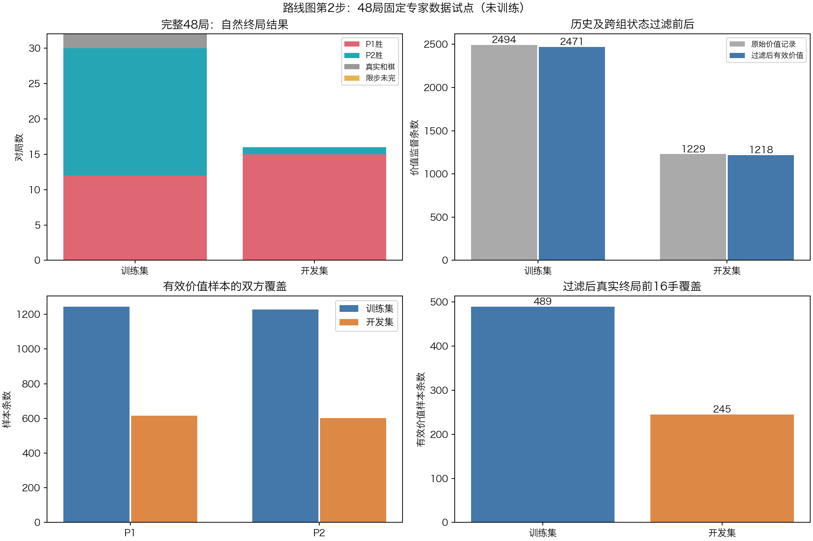

# 路线图第2步：48局专家数据试点

## 结果与阶段状态

**48局按预声明收齐，结构与覆盖门槛全部通过，独立程序完整重放通过。本轮只收集数据，未训练或升级NN。**

过滤后保留2471条训练价值样本、1218条开发价值样本，终局前16手分别489/245条；48个策略探针全部通过根/强制子节点精确分数一致性。最终监督在保守几何轨道层面的跨组、历史重合均为0。

胜负分布仍明显偏移：训练P1胜12/P2胜18/真实和2，开发P1胜15/P2胜1。数据有效与分布稳定是两件事，本试点不能写成已经修好了阵营偏置。保留原分组和所有结果，不按输赢补局。

## 固定协议

- 16个训练开局组、8个开发组，每组两局交换两种固定搜索配置所在阵营，共48局。P1始终先手，strict规则和等轮判和不变。
- 近库、离库、滞后三桶各8组；训练分配6/5/5组，开发2/3/3组，分组在开局生成前锁定。
- 近库：书前4手，随机到6手锚点，再派生搜索到14手，双方平均出营至少4.5子。
- 离库：随机6手后派生搜索到24手，平均出营至少6子。
- 滞后：随机合法到14手，平均出营至多4子。
- 所有根及6手锚点均按历史保守镜像＋旋转换色轨道排除，24组根及锚点各自唯一；每组最多96候选，不按NN错误或后续胜负筛选。
- 两配置为121格Clysto评估派生搜索和tip距离C-PVS，均固定depth5、单次120秒安全上限、最大240手；实际对局关闭开局库。它们不是原版Clysto与NN的棋力对战。
- 预声明总预算一小时，实际1743.8秒（约29分4秒），含历史增量检查和开局生成。正式对局约1534秒，平均每局32秒。
- 本轮子代理触及用量上限，未继续调用子代理；数据代理早期方法建议用于协议设计，最终由主代理和另一个只读程序审计，不称三代理独立复核。

## 完整棋谱结果

|划分|组数|对局|P1胜|P2胜|真实等轮和|限步未完|
|---|---:|---:|---:|---:|---:|---:|
|训练|16|32|12|18|2|0|
|开发|8|16|15|1|0|0|
|合计|24|48|27|19|2|0|

全部48局真实结束，没有把限步或静态进度伪造成胜者。连续局面高度相关；这是24个开局组，不把3723条原始监督当3723场独立比赛。原始棋谱逐条保存在games.jsonl，包含每步实际搜索配置、深度、分数、节点和完整路径。

## 标签与导出语义

实际终局标签从当前走棋方视角给出：胜+1、负−1，真实规则和棋0且value_weight=1。max_ply未完局预定value_weight=0；本轮没有此类对局。只从正式采集root后导出样本，不把共同开局前缀当全新监督。

策略与价值分别设权重：

- 实际派生搜索走法policy_weight=1；tip配置走法policy_weight=0，仅贡献真实轨迹的价值。
- 每局tip首次行动前另查询一次派生教师建议，并强制走建议再搜child depth4，要求和root depth5精确同分。48/48通过；这些未执行建议的额外样本value_weight=0，不继承实际对局胜负。
- 导出1843条实际派生策略监督（训练1235、开发608），另48个探针（训练32、开发16）。所有探针均带split。
- dataset.pt里sets分train/development，policy_probes单列。步骤3必须按split读取探针，并分别归一policy/value损失；旧单权重训练器不适配，不能直接使用。

旧历史状态和跨训练/开发几何轨道在双方监督均屏蔽，完整棋谱和原始结果始终保留、不移动开局组。本轮原始轨迹跨组轨道也恰好为0；历史状态共34条（训练23、开发11）被排除。

|过滤结果|训练|开发|
|---|---:|---:|
|原始采集记录|2494|1229|
|有效价值样本|2471|1218|
|有效独立开局组|16|8|
|真实终局前16手样本|489|245|
|实际派生策略样本|1235|608|
|额外有效策略探针|32|16|

本机dataset.pt约26.9MiB，SHA为a68336186e57d78ac1a39a4da413468e515452fd606da8734c93d8b523b0ef8d。模型和完整历史清单不上传，本目录保留完整棋谱、监督元数据、冻结开局、探针与哈希。

## 独立重放审计

diagnostics/audit121_pilot48.py不调用搜索或训练，独立检查：

1. 24组根/锚点与历史隔离、三桶数量、16/8组划分和同组交换引擎位置。
2. 48局每步合法、actor对应、搜索均完整depth5、真实终局与手数一致。
3. 3723条原始监督逐条重建编码、合法canonical动作顺序、目标、side-to-move标签、双权重和过滤原因。
4. 导出dataset逐条与重建结果比较；探针的prefix、建议合法性、精确分数、来源、split、无胜负权重逐项核对。
5. 最终监督跨split轨道0、历史轨道0，原冠军及注册表SHA保持不变。

审计通过，详见independent_audit.json。预声明10个结构和覆盖门槛全部通过；它们没有要求自然胜负分布一致，因此不能据此宣称分布偏移消失。

160项本机测试通过；暂存区干净检出构建C内核和分析专家后160项完成、4项可选数据依赖跳过、其余通过。没有修改C内核、规则或现役模型。

## 仍需正视的分布变化

|观察|训练|开发|
|---|---:|---:|
|自然P1胜局比例（含和棋分母）|37.5%|93.75%|
|根局面P1前向进度相对P2均值|−0.256|+0.225|
|同一开局组两局胜者相同|11/16组|7/8组|

开发根在这个简单几何量上偏P1，结果也偏P1；这说明仅交换引擎所在阵营不能保证棋形和结果分布对齐，并非胜负标签写反。不能把相关观察当成唯一原因，也不能在看到输赢后重分当前数据。

数据自身的零值基线MSE为训练0.9344、开发1.0000；仅用训练集按玩家均值作预测，在开发约1.294，说明阵营先验会受分布翻转冲击。所有基线只用训练标签定参数，不用开发标签拟合。

下一步可以把本数据用于角色先验翻转的压力诊断：价值模型须与零值、仅训练集拟合的阵营/阶段先验比较，分双方、真实终局距离和开局组报告。只报总体准确率可能掩盖捷径；按游戏组统计，不能把相邻样本当独立证据。

未来常规开发开局应在查询结果之前按可观测根进度等特征分层，再固定split；当前分组保持不变，不挑补局。本次开发集从此计入已使用开发历史，不作为后续冠军独立终验。

## 下一步：路线图第3步的准备

第2步有限试点已完成。第3步尚未启动，先实现并验证支持双权重的读取/损失，禁止开发探针进入训练，保留P1先手身份。然后预声明一次小规模价值信息增益对照，检查是否能在未见开局组上优于零值与训练先验，尤其真实终局附近，同时保持策略能力。

这批数据是专家搜索轨迹与监督，不称为纯自对弈。通过模型开发和后续NN+MCTS检查后，才进入全新整局晋升验收；当前GUI仍为v3及可关闭的开局库。

## 复现

采集入口expert121_pilot48.py --out <不存在的新目录>。原始本机目录nn_checkpoints/experiments/expert121_pilot48_20261105/含源快照、完整history_exclusions.json和dataset.pt；不要重复使用已存在目录重跑。

只读审计：diagnostics/audit121_pilot48.py <实验目录> --output <审计JSON>。
中文绘图：diagnostics/plot121_pilot48.py <实验目录>，使用带matplotlib的Python。
config.json保存搜索配置、种子、桶定义、门槛及来源SHA；artifact_sha256.json保存本机二进制/数据和审计工具SHA。
