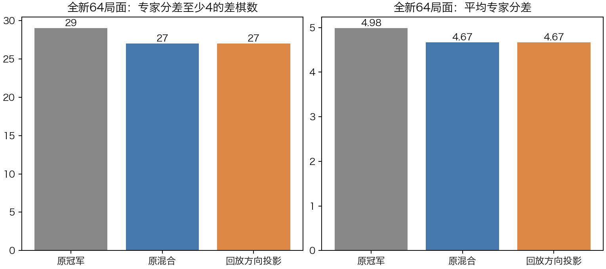
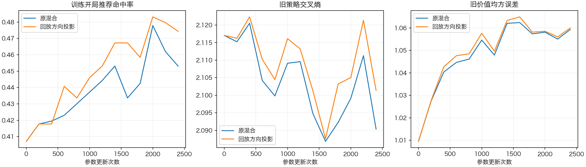

# 全新对称隔离开发集与广开局回放投影

## 结论与决定

**新开发集已完成严格隔离与冻结；广开局训练有小幅静态改善，回放方向投影没有带来额外主指标收益。本轮未通过，不进入晋升对战。**

在64个新局面上，v3差棋29个，普通混合与投影均为27个；平均专家分差4.984375→4.671875。投影提高了训练开局库命中（45.3%→47.4%），但相对控制没有减少新局面差棋或平均分差。价值MSE还比预声明门槛高0.000440。按计划停止这套投影配置，保留v3。

## 先建立了什么数据基础

历史清单覆盖1134个JSON/JSONL/PT来源，包含完整棋谱的中间状态、显式(board,player)和decision_id，以及417个安全读取的PT、31680个数值训练样本。局面按左右镜像＋旋转180°并交换双方归一。

历史20条末局日志缺少原始前缀。根据原curriculum121.py的准确构造，由teacher_games与split恢复前缀，并逐条核对group、胜方、prior/candidate顺序、start_ply、plies及全部走法。新增180轨道后，历史排除集共**281785个等价轨道，未解决的121格覆盖缺口为0**。旧418个81格pickle/npz不读取、不混用。原缺口证据及恢复来源哈希保留，没有修改历史原件。

全新开发集使用固定seed111051、最多4096次候选，最终32个全新六手开局分支，每分支取P1/P2各一个连续根：

- 共64个唯一根，双方各32；己方第7/8/9/10步各16。
- 根及六手分支锚点与历史281785轨道、原693个开局书样本均无对称等价重合；候选仅拒绝1个旧分支。
- 从标准初始局面出发的共同早期前缀允许相同；新颖性声明针对根和六手分支锚点。
- 先固定所有合法前缀，再查询教师；不按NN错误选择局面。
- 固定深度5的121格Clysto评估派生搜索给建议，强制建议动作后的depth4分数必须与根分数完全一致。64/64通过，全部value_weight=0。
- schedule与标签SHA冻结，开发标签从未用于反向训练；两组最终权重固定后才各评一次，v3也仅在此时评一次。

独立数据审计见[data_audit.md](data_audit.md)和[data_audit.json](data_audit.json)。完整历史轨道清单仅本机保留，公开[history_coverage.json](history_coverage.json)含来源哈希、覆盖计数、恢复证据和完整清单哈希。

## 两组固定训练对照

训练池仍为原565个开局库样本，不再只围绕32难例。两组相同v3初值、2400更新、每批4开局+6原教师+6普通专家、lr3e-5、AdamW/weight_decay1e-4、全局clip1；根/普通种子111052/111053，抽样序列哈希一致，专项暴露9600次（平均约17次/例）。

原混合损失为0.25开局集合CE + 0.75普通策略CE + 真实价值MSE + 0.1旧策略KL + 0.1旧价值输出保留。

投影组只改普通策略回放与专项冲突的方向：在共享CNN及policy参数上计算已加权梯度a、b，若a·b<0，以detached系数c=−a·b/||a||²，将回放变为b+c·a。实现损失为`(1+c)*root + replay + aux`；独立价值头不参与投影、aux保持原样，不再做范数限幅。专项为零时不投影，非有限数值立即失败。

每200步记录原训练拟合、旧能力和真实Adam参数增量，不看新开发。只用最终2400步权重，未挑中间最佳点、未扫描系数。两组及标签评测约332秒，实际教师查询197次，低于320次上限。历史全量扫描单独在训练前完成。

## 全新开发结果

训练使用原Clysto开局库推荐；新开发使用固定depth5的121格派生搜索。两种教师并非同一个目标，因此分别报告“库招命中”和“相对固定深度专家的走法分差”。本轮评价原始策略首选，无外部开局库代走，也不把它写成MCTS整局胜率。

对每个模型实际动作，用强制子节点depth4搜索计算Q；分差gap=S−Q，其中S为教师根分数。gap=0接受所有同分实际走法，不要求与唯一建议端点相同；gap>=4为预声明差棋。出现负gap则整轮报错，不截断成0。没有遍历所有合法动作，不称完整best-set。所有根及相关强制动作均非终局，故本轮均值无±100000终局值。

|模型|差棋数/64↓|专家同分数/64↑|平均分差↓|
|---|---:|---:|---:|
|v3|29|21|4.984375|
|普通广开局混合|27|23|4.671875|
|回放方向投影|27|25|4.671875|

投影与控制有61/64例实际起终点相同。不同的3例分别为gap9→14、2→0、3→0：两次改善共5分，被一次恶化5分抵消，三例差棋分类都没改变。同分数增加2是真实的，但没有带来差棋或平均分差收益。

按32分支配对的分差变化：控制对v3为6改善/9恶化/17相同，投影对v3为8/9/15；投影对控制为2/1/29。两训练组相对v3少2差棋，改善集中在P1：差棋10→8，P2均19，P2平均分差反而增加。两方根不是互为转方对称的同一局面，不能据此判定颜色bug。完整分层和逐例变化见[evaluation_audit.md](evaluation_audit.md)及JSON。

## 训练拟合与旧能力

|指标|v3|原混合|投影|
|---|---:|---:|---:|
|565开局训练推荐命中|40.7%|45.3%|47.4%|
|旧128开局诊断命中|37.5%|41.4%|41.4%|
|旧32难例命中|0/32|1/32|1/32|
|653旧策略CE↓|2.117033|2.090342|2.101383|
|653旧价值MSE↓|1.009542|1.059309|1.059982|
|353普通策略CE↓|2.397875|2.279606|2.283146|

旧128含已确认的19个跨组转方等价轨道，仅作历史诊断，不当全新泛化证据。旧32在广池里没有被额外强化，暴露次数不同，不把旧32专项实验的29/32门槛套到广池。

预声明六门槛中四项通过、两项失败：

|门槛|结果|
|---|---|
|新差棋至少比控制少4|失败：27对27|
|新差棋不多于v3|通过：27对29|
|新平均分差不高于控制和v3|通过|
|旧策略CE≤v3+0.05|通过|
|旧价值MSE≤1.0595422140|失败：1.0599820807，超0.0004398667|
|普通策略CE≤v3+0.05|通过|

主要失败原因是投影没有额外的新局面主指标收益；价值门槛超出很小，仍按预声明处理，没有放宽或换检查点。普通训练的小幅静态改善保留记录，但不据此事后另挑控制组晋升。

## 实现与多代理复核

投影1287/2400次触发，全部数值有限。57条记录的投影后内积有float32微负，最低−1.90735e−6，全部在预设及独立更严格容差内；表述为“容差内清除负内积”。模型哈希不同、20个参数张量均不同，参数最大绝对差0.00940549；结果相同不是误复制。

数据代理独立审查了历史恢复、64前缀、编码回解、标签一致性、对称隔离与冻结；训练代理独立核对了源码/4数据/原v3及registry哈希、投影所有更新和两个检查点；评测代理独立复算了六门槛、32分支配对、双方/阶段分层与3个变化动作。子代理没有重复训练、查询教师或重新选择开发候选。

本机143项测试通过；暂存区干净检出重建C内核和分析专家后143项完成、4项可选数据依赖跳过、其余通过。无C内核改动。新增测试覆盖安全数值解码、拒绝任意pickle全局对象、历史中间状态与SHA去重、旧末局准确恢复/错误手数拒绝、投影数学及value头梯度保持、固定候选生成与对称排除。

## 下一步

结束当前投影配置，不在本64例上改系数、加步数或挑权重。本64例从此归为已使用的开发历史，后续历史扫描会自动排除。

优先做只读的训练目标与覆盖诊断：按双方与阶段查看565开局池和普通回放覆盖，解释训练命中增加为何只改变3个新局面首选；把“模仿开局库”和“符合固定深度派生专家”分开定义。由诊断决定是否补充开局库之外的专家轨迹，再为下一次新训练预声明一个清晰问题。

本轮没有进入整局确认；GUI保持原v3与可关闭的开局库。只有后续开发通过后，固定候选并做全新、成对交换先后的无库独立整局评测，才考虑晋升。

## 工件与复现

训练入口`fresh121_projection_trial.py --out <新目录>`，默认重新扫描与恢复历史；可用`--history-manifest <已解析清单>`复用清单，程序会逐文件校验哈希及完整文件集合，排除本轮输出。源/数据/模型快照在本机`nn_checkpoints/experiments/fresh121_projection_20261105/`。配置、64合法前缀与教师标签、冻结哈希、三模型实际走法/评分、每步投影与真实Adam探针、抽样审计、中文日志、图和CSV已公开在本目录。模型、旧回放及完整281785轨道清单只本机保存，哈希随报告保留。
