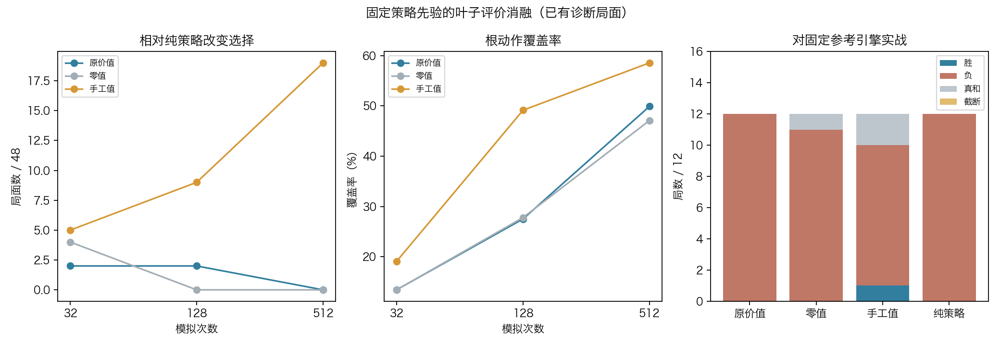

# 叶子评价消融：搜索能响应叶值，现役NN价值未体现收益

路线图第3步，2026-11-07。固定现役v3 CNN策略先验，完成432次局面搜索和48局实战诊断；总304.398秒。无训练、无冠军切换，不是第4步候选达标或新独立棋力验收。

**结论：PUCT并非完全不使用叶子评价。替换为固定手工叶值后，访问分配和实际选择明显改变；但现役NN价值相对零值/纯策略没有在本小批实战体现收益。手工叶值仍明显弱于参考引擎，不能只替换估值便宣布问题已解决。**



## 固定设计

[预声明协议](protocol.md)固定48个已看relay根、v3模型/策略先验、PUCT探索1.5、FPUzero、温度1、无噪声/根安全过滤/启发混合。仅非终局叶值来源改变：

- nn：原NN价值，value_scale1。
- zero：非终局恒0，仍保留真实终局±1/0。
- hand：Clysto派生静态evaluate当前走棋方分数，经tanh(score/40)归一。尺度40事前固定，不扫描；它不是胜率概率。

真实strict终局优先，终局不调用替代函数。hand使用的静态表与参考Clysto派生搜索相同；只替换叶值，没有把它混入策略先验或增加额外搜索。此对照同时改变估值信息内容和数值分布，因此不能将全部效果只归因于准确性或宣称尺度已最优。

局面对照为48根×32/128/512模拟×3臂。实战为前6根×交换NN所在阵营×nn/zero/hand/pure四臂，共48局；沿用完整prefix与重复历史、strict固定P1先手。对手为Clysto评估派生121（非完整原版）。前三臂及参考对手名义单步0.1秒软预算，pure仅一次CNN全合法argmax、不刻意耗时。不开训练，不补局、不按结果选根。这些是已看中局诊断，不具有全新独立验收身份。

## 局面上的搜索响应

|叶值|模拟数|偏离纯策略选择|平均根动作覆盖|平均耗时|
|---|---:|---:|---:|---:|
|NN|32|2/48|13.44%|25.02毫秒|
|NN|128|2/48|27.52%|88.19毫秒|
|NN|512|0/48|49.89%|383.43毫秒|
|零值|32|4/48|13.42%|27.31毫秒|
|零值|128|0/48|27.79%|91.07毫秒|
|零值|512|0/48|47.08%|375.70毫秒|
|手工值|32|5/48|19.09%|21.85毫秒|
|手工值|128|9/48|49.13%|94.90毫秒|
|手工值|512|19/48|58.54%|376.77毫秒|

这说明搜索选择确实能受叶值影响，先前512次仍与纯策略相同并非“实现完全忽略value”。但改变动作不是质量证明。

原11个两配置同向偏好根中，NN、零值全部档位及手工32/128均为选偏好方3、非偏好方4、候选外未知4；手工512为3/5/3，没有显示pair收益改善。候选外没有新续弈标签，不能算错招。偏好来源可含“两条都胜而一条更快”的tempo；现有MCTS未直接奖励胜局步数差，不能将所有不命中解释为回传错误。[全部记录](artifacts/cases.jsonl)，按train/development拆分汇总见[result](artifacts/result.json)。

## 实战对照

|策略／叶值|胜|负|真实和棋|截断|对参考总积分|
|---|---:|---:|---:|---:|---:|
|NN值|0|12|0|0|0|
|零值|0|11|1|0|0.5|
|手工值|1|9|2|0|2|
|纯策略|0|12|0|0|0|

48局全部真实结束：45局all_pieces_in_goal，3局equal_turn_goal_draw。手工臂在group1/P1取胜，group0/P2、group2/P2和棋；零值臂group4/P1和棋，其余为负。[全部48局](artifacts/games.jsonl)。

|实际think统计|NN值|零值|手工值|纯策略|
|---|---:|---:|---:|---:|
|我方平均墙钟|104.79ms|104.44ms|104.37ms|1.13ms|
|我方最长墙钟|166.52ms|165.58ms|161.36ms|5.48ms|
|我方超过110ms|31手|30手|27手|0手|
|参考平均墙钟|99.83ms|99.98ms|98.82ms|99.89ms|

前三臂是相同接口软预算，实际时间并非严格相同，NN至少完整一次模拟、在模拟边界停止，单次展开可超时。纯策略是额外低耗时基线，不冒称等计算量。参考按时间截止的节点/走法也会受计时波动影响；同一对手并不保证每局走出完全相同轨迹。因此这里仅给描述性小样本结果，不计算普适胜率、不将1胜2和称统计棋力提升。

NN值约百倍于纯策略的每步耗时，并未在这12局对参考得分上体现收益；这不证明两者所有局面棋力相等。零值也取得一和，说明不能用单局差异简单断定NN价值有害。手工臂结果为叶值替换提供了局部正向迹象，但仍9负，且原11pair未改善，不能把它登记为新冠军。

## 正确性与独立复核

新增6项叶值测试：原board/当前方视角、多层回传、替代后再缩放、真实终局不调用callback、不受缩放、非法NaN/inf/越界拒绝、None与原行为一致。全项目229项本机测试通过（4.261秒）。生产搜索只加可选leaf_value_fn=None；现役GUI/registry没有启用它，C内核未改，无需重编译。

[独立审计](artifacts/independent_audit.json)：48根、432cases、48局2480手核验；重算48根纯策略与300手pure实战argmax、根静态tanh；13项源码/native/输入hash和冠军/registry通过。不重复MCTS，不因审计选择配置。深度只根据归档范围与摘要校验，不声称重建完整内部树。[独立设计审查](independent_review.md)。

```sh
/Users/liuzirui/miniconda3/envs/checkers/bin/python diagnostics/audit_leaf121_ablation.py
/Library/Frameworks/Python.framework/Versions/3.10/bin/python3 diagnostics/plot_leaf121_ablation.py docs/experiments/leaf121_ablation_20261107
```

原件在本机nn_checkpoints/experiments/leaf121_ablation_20261107；公开[工件清单](artifacts/artifact_manifest.json)、配置/原结果/完整记录和执行源码。冠军仍v3，SHA为a0a40208061aaaa45931131f1760bb20ae114388c6ae6ad29181b204565395d9，无模型产物，实验和caffeinate已结束。上一轮c4dea77已成功推送。

## 对用户问题的判断

目前证据支持两个方向：当前NN价值没有给搜索带来可见增益；即使同源手工评价，Python逐叶CNN的PUCT仍无法在约100ms下匹敌原生C搜索。本轮没有发现确定性反号或终局bug，也没有隔离证明差距全来自PUCT算法、实现吞吐或某个估值尺度。

下一步应保持固定评价，进一步区分搜索吞吐和选择机制，优先测量NN前向、Python合法走法/规则、树管理各占多少时间，再设计同一评价下的预算对照；继续保留CNN路线。暂不盲增模拟数、调尺度或用这些已看开局反复验收新模型。
