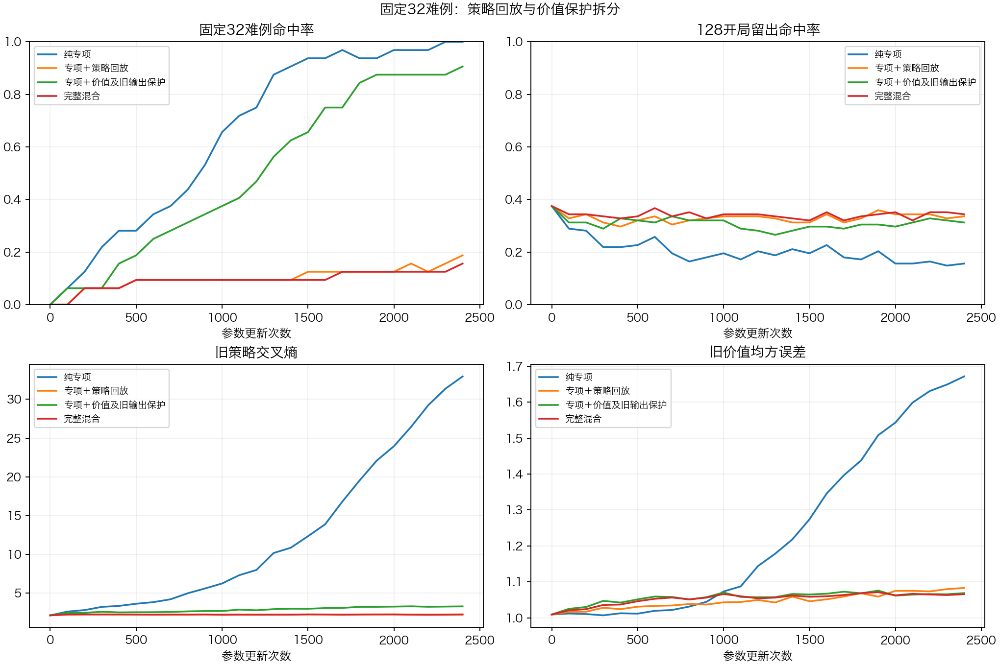

# 固定32开局难例：策略回放与保护目标拆分

## 结果与决定

**压住这批开局专项学习的主要因素是普通策略回放。** 同样2400次更新，纯专项32/32；加策略回放6/32；加价值/KL保护29/32；完整混合5/32。继续使用现有CNN，下一步改回放更新的平衡方式。

四组都未同时满足专项拟合与旧能力保护，本轮不升级模型。GUI继续v3和可关闭的外部开局库。实验约349秒完成，后台训练已结束。

## 预声明与实验设置

本轮接续[上一轮32难例实验](../opening121_hard32_20261104/README.md)。沿用原32训练局面（16镜像轨道、11开局分支、双方各16、第7/8/9/10步各8），不新增数据、不按本轮结果重新挑题。原样本前缀/编码/合法动作/运行时推荐集合已逐例核验，普通回放与32例的完整编码精确重合为0。

四组从同一v3开始，每步相同4例专项与12例普通候选，2400次更新、专项暴露9600次；普通候选为6原教师+6普通专家训练样本。根与普通序列联合哈希四组一致。所有组均以前向16例计算所需分量，未启用的分量不加入反向损失。无保护目标的两组冻结独立价值头参数，共享CNN仍训练。

|组别|专项集合交叉熵|普通策略交叉熵|价值/KL保护|
|---|---:|---:|---|
|纯专项|0.25|无|无|
|专项+策略回放|0.25|0.75|无|
|专项+价值/KL保护|0.25|无|有|
|完整混合|0.25|0.75|有|

保护目标整体为真实终局价值MSE + 0.1旧策略KL + 0.1旧价值输出保留。开局专项样本value_weight=0，不虚构胜负。优化器AdamW、lr3e-5、weight_decay1e-4、梯度裁剪1；训练初值和现役注册表哈希在运行前后不变。

每100步评估全部32例与原留出、每200步采样当前批三项梯度，共每组12批；每步记录裁剪是否发生。预算上限一小时，固定最终2400步，基本拟合门槛29/32；旧策略CE与价值MSE均不超v3+0.05作为保护参考。此处沿用留出作诊断，不作为独立冠军验收。

## 最终指标

命中率是原始网络在合法动作中的首选落入专家推荐集合；不调用外部开局库代走。CE/MSE越低越好。

|模型/组别|专项32命中|128开局留出命中|653旧策略CE|653旧价值MSE|353普通留出CE|
|---|---:|---:|---:|---:|---:|
|v3初值|0/32|37.5%|2.117|1.010|2.398|
|纯专项|32/32|15.6%|32.950|1.671|32.293|
|加策略回放|6/32|33.6%|2.246|1.083|2.366|
|加价值/KL保护|29/32|31.2%|3.275|1.069|3.364|
|完整混合|5/32|34.4%|2.218|1.066|2.355|

完整混合组复现上一轮的5/32，旧策略CE与价值MSE也逐值一致。纯专项同样32/32；本轮用16例批次计算专项、上轮纯专项只前向4例，末态误差数值有小幅变化，未改变“能拟合但严重遗忘”的结论。

## 如何理解这次结果

**第一，CNN有能力记住这批题。** 纯专项再次学会32/32。只保留价值/KL保护也能学会29/32，达到预声明基本拟合门槛。

**第二，普通策略回放显著压制了新开局学习。** 没有价值/KL保护时，加回放使32/32变成6/32；有保护时，加回放使29/32变成5/32。这两个对照方向一致，下一步应针对回放处理，而非继续增加相同数据。

**第三，保护目标仍有代价，也未保护到位。** 加保护后专项从32降至29，同时明显缓解纯专项的灾难性遗忘，但旧CE仍升到3.275；完整混合虽将旧CE控制在2.218，仍超出预声明2.167上限，价值MSE1.066也超过1.060上限。四组没有一组同时过关。

**第四，梯度记录支持回放干扰的判断。** 仅回放组12个训练过程采样批中10批回放与专项梯度方向相反，平均余弦-0.287，回放/专项梯度范数比平均1.88；完整混合也是10/12批方向相反、平均余弦-0.282、范数比1.78。这里取共享CNN与策略参数，排除独立价值头；未启用项仍可只读计算梯度，不代表该项参与更新。

|组别|发生裁剪的更新次数|平均裁剪前总梯度范数|
|---|---:|---:|
|纯专项|2006/2400|4.01|
|加策略回放|2400/2400|7.58|
|加价值/KL保护|2400/2400|7.52|
|完整混合|2400/2400|9.45|

记录显示专项与回放梯度存在冲突，并处于持续裁剪状态。下一轮测量AdamW实际更新，检查回放限幅能否改善学习。仅保护组也每步裁剪却学会29例，因此不能只把裁剪阈值调大就当成修复。12批梯度用于安排后续对照。

## 后补验证划分审计（2026-11-05）

独立子代理发现原565/128开局划分存在19个旋转180°+换色等价轨道跨组，涉及训练38例和留出38例、固定32中2例。原128只作历史诊断，不作为严格全新等价局面的泛化证据。详见[后续数据审计](../opening121_replay_cap_20261105/data_audit.md)。本轮固定32的训练拟合对照不依赖这些留出判定。

## 下一步建议

下一轮只改变回放更新的量级：保留当前专项与价值/KL目标，对策略回放梯度设置相对专项梯度的上限。做原完整混合与受限回放的固定预算对照，保持同一数据序列；同时追踪专项掌握、旧CE/价值、冲突批次与有效更新量。先不同时引入梯度投影、换优化器或大幅增加步数，以便判断单个修改的作用。

只有同时达到专项至少29/32、旧CE与价值误差各不超v3+0.05，才值得扩大到更多后段训练局面与全新开局分支。之后再固定候选做独立整局对战；本轮记住训练题不记为棋力晋升。

## 工件、复现与验证

- 训练入口：`ablate_opening121_hard32.py --out <不存在的新目录>`。需要本机保存的v3与上轮原始数据。
- 绘图：`diagnostics/plot121_opening_ablation.py <实验目录>`，使用简体中文字体并检查字形。
- 本机完整目录：`nn_checkpoints/experiments/ablate_opening121_hard32_20261105/`，含源码/数据快照和四组0/600/1200/1800/2400检查点。
- 本公开目录保留配置、原32前缀/标签、四组逐例轨迹、曲线、梯度、裁剪统计、中文日志、中文PNG/SVG/CSV及原始模型/源码哈希；不提交模型大文件。
- 本机完整124项测试通过；暂存区干净检出重新构建C内核和分析专家后，124项测试完成、4项可选数据依赖跳过、其余通过。新增测试核对完整损失等价、四格组合关系及只读梯度检查不修改参数梯度。无C内核修改。
