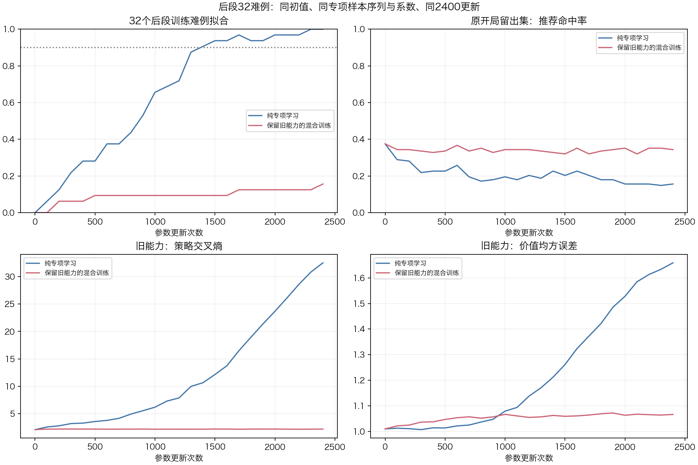
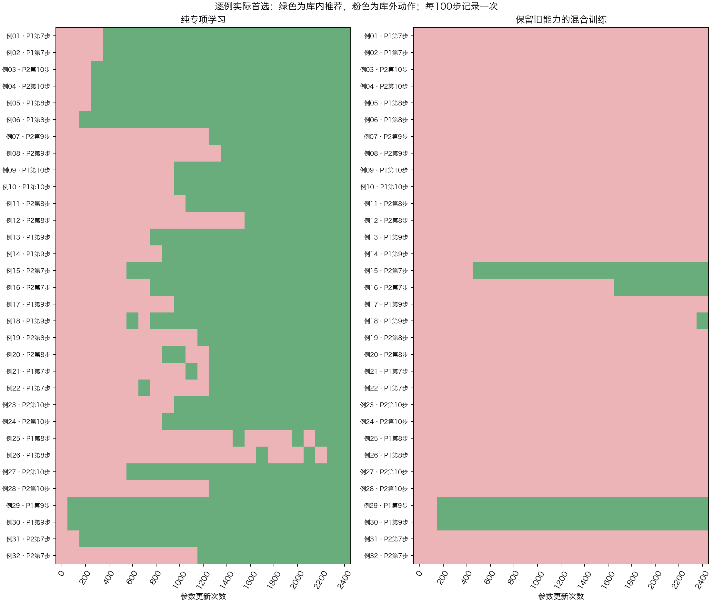

# 开局第7—10步：固定32难例拟合实验

## 结论

现有CNN能学会这32个持续错误的开局局面：纯专项组32/32；现有混合训练组只有5/32。当前优先修训练目标之间的干扰与旧能力保护，不扩大数据、不更换架构。

纯专项模型记住了训练题，同时严重遗忘旧策略；两组都不用于GUI，不注册新冠军。当前仍为v3 + 可关闭的Clysto外部开局库。

## 实验设计与预算

从上一轮修正版份额实验中，选取v3和75%开局份额模型都答错的192个第7—10步训练局面。只使用原训练池，128留出局面不参与选择。

固定32例来自16个完整左右镜像轨道、11个六手开局分支；红青各16例，己方第7、8、9、10步各8例。逐例重放前缀，核验编码、合法动作顺序与运行时开局库推荐集合。记录的前缀包含合法镜像路径；分支数按左右镜像归组。

|设置|纯专项|混合训练|
|---|---|---|
|初始权重|v3|同一v3|
|参数更新|2400次|2400次|
|每步专项局面|4例|相同4例，顺序完全一致|
|专项集合交叉熵系数|0.25|0.25|
|专项样本暴露量|9600|9600|
|普通回放|无|6原教师 + 6普通专家局面|
|其余训练目标|无|真实终局价值、0.1旧策略KL、0.1旧价值输出保留|
|价值头参数|冻结|训练|

优化器均为AdamW，学习率3e-5、权重衰减1e-4、全局梯度裁剪1。纯专项每步计算4例，混合每步16例；对齐的是专项暴露与系数，不是计算量。纯专项冻结价值头参数，但共享CNN更新仍会改变价值输出。

预声明基本拟合门槛29/32，高拟合31/32；固定看最终2400步，不挑验证集最佳检查点。每100步记录全部32例实际首选、推荐概率与分数间隔。两组训练约125秒；原始工件保存代码/数据/模型哈希与检查点。

## 最终结果

命中指原始网络的合法动作首选落在专家开局库推荐集合中；训练与诊断均不调用开局库代走。交叉熵与均方误差越低越好。

|指标|原v3|纯专项|混合训练|
|---|---:|---:|---:|
|固定32难例命中|0/32|**32/32**|**5/32**|
|其他533训练例命中|43.2%|17.3%|39.8%|
|128开局留出命中|37.5%|15.6%|34.4%|
|653旧能力留出策略交叉熵|2.117|32.502|2.218|
|653旧能力留出价值均方误差|1.010|1.659|1.066|
|353普通留出策略交叉熵|2.398|31.863|2.355|

纯专项在2300步首次32/32，2400步保持；期间6例有过学对后再错，最终全部恢复。混合组在每100步的记录中仅5例曾经答对、最终也为这5例，峰值5/32。主要表现是27例持续未学会，而非已经全学会再被覆盖。

## 原因核查

1. **这批样本可以被当前CNN拟合。** 专项组全部学会，优先检查训练组合。所选32例的局部表示矛盾对审计为0。
2. **没有发现直接相反的同输入回放标签。** 用完整编码输入比对，32例与本次普通训练回放的精确重合为0。需要解决的是不同任务对共享参数的更新干扰。
3. **回放更新是下一轮优先拆查项。** 固定抽8批，在v3与混合最终权重各做只读梯度测量，排除独立价值头参数。v3时回放/专项梯度范数比均值1.07、方向相反4/8批；混合结束时范数比2.31、方向相反6/8批、平均余弦-0.190。真实价值及KL/输出保留合并项的范数约专项1.12倍、方向相反3/8批。此处是两个参数点的局部证据，用于安排消融次序。
4. **纯专项的泛化与旧能力明显退化。** 32/32只代表固定训练题拟合成功。原开局留出与旧策略均变差，这个检查点没有部署价值。

## 下一步实验建议

继续使用这32例与同一专项序列，以同v3、同2400次更新和0.25专项系数，拆成四组：纯专项、专项+普通策略回放、专项+价值/KL保护、完整混合。逐组记录专项拟合、旧策略/价值、梯度范数与方向、裁剪触发情况，确定哪一组目标压制学习，再设计交替训练或权重调整。

下一轮先诊断，不增加自对弈局数、不切换网络、不拿当前留出集反复选新冠军。恢复专项学习后，另用全新开局分支检查泛化；满足开发门槛再进入固定预算独立整局对战。本轮没有整局评测，未晋升模型。

## 复现与保存

- 训练入口：`fit_opening121_hard32.py --out <不存在的新目录>`，使用本机原始数据与权重。
- 只读诊断：`diagnostics/audit121_opening_hard32.py <实验目录>`。
- 中文绘图：`diagnostics/plot121_opening_hard32.py <实验目录>`。
- 原始本机目录：`nn_checkpoints/experiments/fit_opening121_hard32_20261104/`。
- 本目录保存配置、32例完整前缀与标签、两组逐例轨迹、全部曲线、抽样序列哈希、梯度检查、中文图和日志；模型与训练回放按项目规则仅本机保留，哈希在`artifact_sha256.json`。
- 训练脚本快照与当前训练源码哈希一致；后补只读审计源码单独存档。

验证：本机122项单元测试通过；暂存区干净检出后，C内核与分析专家均构建成功，122项测试完成、4项可选数据依赖跳过、其余通过。无C内核修改。
