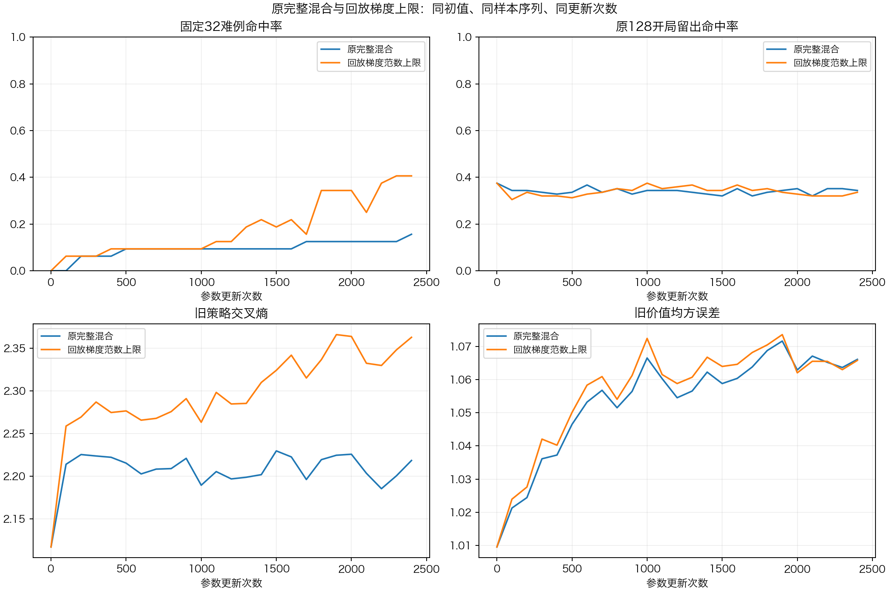

# 回放梯度上限实验与开局划分审计

## 结论与决定

**回放限幅让固定难例从5/32增加到13/32，但旧策略遗忘加重；本轮未通过，不部署新权重。** 范数上限实现和原控制复现均经独立子代理复核。下一步先完成新开发数据的完整对称隔离，再研究能同时保护旧策略的训练方法，不继续在相同32题上反复扫限幅值。

本轮同时发现并补上一个验证漏洞：旧565训练/128留出中，38个留出局面与训练局面旋转换色等价。原留出只作诊断，不作为严格新局面泛化证据。已新增可复用审计工具，历史样本保持原状用于复现。

## 预声明与实施

固定上一轮32个第7—10步难例、v3初值、每批4专项+6原教师+6普通专家样本，根与普通抽样种子110414/110415；每组2400次更新、专项暴露9600、普通暴露28800。原配方和限幅组执行相同梯度读取与检查，固定最终2400步，不选择最佳中间权重。

- 原配方：0.25专项集合CE + 0.75普通回放CE + 原aux。
- 限幅组：仅给已经含0.75系数的回放CE再乘 `s=min(1, ||g_专项||/||g_回放||)`；系数detach。比较共享CNN和策略头的联合L2范数，排除独立价值头。回放梯度为0时取1，专项为0而回放非0时取0；非有限范数立即失败。
- aux不变：真实终局价值MSE + 0.1旧策略KL + 0.1旧价值输出保留；专项value_weight=0，不制造胜负。
- AdamW、lr3e-5、weight_decay1e-4、全局clip1保持不变。不做梯度投影，不更换CNN，不调上限系数。
- 每步记录根/回放范数、缩放系数、损失、方向余弦、总梯度对根内积和裁剪；每100步记录全部32实际首选及旧留出；每200步记录aux及Adam真实参数增量。

预算一小时，两组约332秒结束。诊断门槛：最终至少29/32、旧策略CE和旧价值MSE各不超v3+0.05，普通留出CE也不超v3+0.05。全部通过才值得计划扩大训练及全新开发验证；本轮不运行对战、不注册模型。

## 最终结果

命中是原始网络合法动作首选落入专家开局库推荐集合，不使用开局库代走。CE和MSE越低越好。

|指标|v3初值|原完整混合|回放范数上限|
|---|---:|---:|---:|
|固定32难例命中|0/32|5/32|**13/32**|
|原128开局留出命中|37.5%|34.4%|33.6%|
|653旧策略留出CE|2.117|2.218|**2.363**|
|653旧价值留出MSE|1.010|1.066|1.066|
|353普通留出策略CE|2.398|2.355|2.493|

原完整混合的最终完整指标与上一轮逐值一致；基线指标也逐值一致，代码/数据/原v3/现役注册表哈希全部核验通过。

精确门槛为旧CE≤2.167033、旧价值MSE≤1.059542、普通CE≤2.447875。限幅组的拟合、旧CE、旧价值、普通CE四项全部失败。难例多答对8个说明优化行为确实变化，但旧能力代价仍过大。

## 限幅究竟做了什么

|过程指标|原完整混合|回放范数上限|
|---|---:|---:|
|回放缩放激活次数|0/2400|2350/2400|
|平均缩放系数|1.000|0.487|
|回放与专项原梯度相反批次|1711/2400|1824/2400|
|总原梯度与专项梯度相反批次|430/2400|52/2400|
|全局裁剪次数|2400/2400|2400/2400|
|实际Adam步朝专项下降方向的采样次数|9/12|11/12|
|实际Adam步与专项下降方向平均余弦|0.084|0.168|

所有2400次限幅后原始回放梯度均守住专项范数上限。两个训练轨迹的原始冲突批次数不能当成同参数点因果比较；限幅本身只改大小，不改变回放与专项之间的夹角。

真实参数增量检查表明，限幅组的Adam更新更贴近专项下降方向；平均实际步长0.001676→0.001689，并非仅缩小总步长。这符合难例拟合增加的现象。另一方面，旧策略误差上升，说明减少回放拉力还没有解决记忆保持。范数限制不保证Adam预条件/动量之后的贡献比例，也不保证终局棋力提升。

## 数据审计的新发现

数据子代理独立重放了32例：前缀、完整输入、合法动作顺序和实际运行开局库推荐均32/32通过。5521个普通训练样本与固定32/开局128在精确棋盘、镜像和转方等价轨道上重合均0，653旧能力与353普通留出也无相应重合。

但是，开局565训练/128留出原来只按左右镜像分组；加入180°旋转并交换双方颜色/走棋方后，**19个等价轨道跨组，涉及38训练例和38留出例**。固定32中2例也对应这些留出等价轨道。编码保留原player身份平面，故不是完全相同输入张量，但这些留出局面不能视为全新等价局面。

- 完整证据：[data_audit.md](data_audit.md)、[data_audit.json](data_audit.json)。
- 新工具`opening121_split_audit.py`提供完整等价归一和跨组审计；`--strict`发现重合时返回非0。
- 原128开局、653旧能力、353普通留出已被多轮诊断使用，后续模型选择必须使用全新开局及未参与选择的独立整局验收。
- 本轮不更改历史数据，以保持原控制可复现；未来新划分按镜像+转方完整轨道一起隔离。

## 下一步

1. **先建立干净的新开发集。** 新开局分支在生成前固定预算与种子；用完整等价轨道审计，排除当前训练与旧开发局面，停止将原128命中率作为泛化成果。
2. **训练方法转向处理方向冲突。** 本轮已验证单纯缩小回放有帮助但不够；下一项应在更广的训练池预声明一次方向冲突处理或更新安排对照，各组数据和预算固定，继续核查旧能力和真实参数更新。不对同一上限反复扫参。
3. **通过开发门槛后才整局验收。** 固定候选，使用全新成对交换先手的开局，无外部开局库作为NN学习效果主评测；与旧冠军及同规则C引擎对战，同库实战可另作辅助。保留v3直至独立验收通过。

本轮不将13/32称为棋力提升，GUI仍为v3与可关闭的Clysto开局库。

## 多代理协作与验证

主代理负责实验实现、运行、文档整合与main提交；三个子代理分别只读复核训练实现、数据和评测，按文件范围隔离写入。数据代理仅新增审计工具、测试和审计报告。审查摘要见[review_notes.md](review_notes.md)。

本机132项测试通过；暂存区干净检出构建C内核和分析专家后，132项完成、4项可选数据依赖跳过、其余通过。无C内核变更。新增测试覆盖控制全部参数梯度等价、value头aux梯度保持、系数detach、零/非有限范数、上限、对称轨道不变性和19/38/38重合回归。

本目录保存配置、32例完整前缀/标签、两组逐例轨迹、每步梯度/系数/裁剪记录、真实Adam步探针、中文日志、PNG/SVG/CSV及哈希；模型与原回放仅本机保存。原始目录：`nn_checkpoints/experiments/cap_opening121_replay_20261105/`。训练入口`cap_opening121_replay.py --out <新目录>`，绘图入口`diagnostics/plot121_replay_cap.py <实验目录>`；源与数据快照保留。
