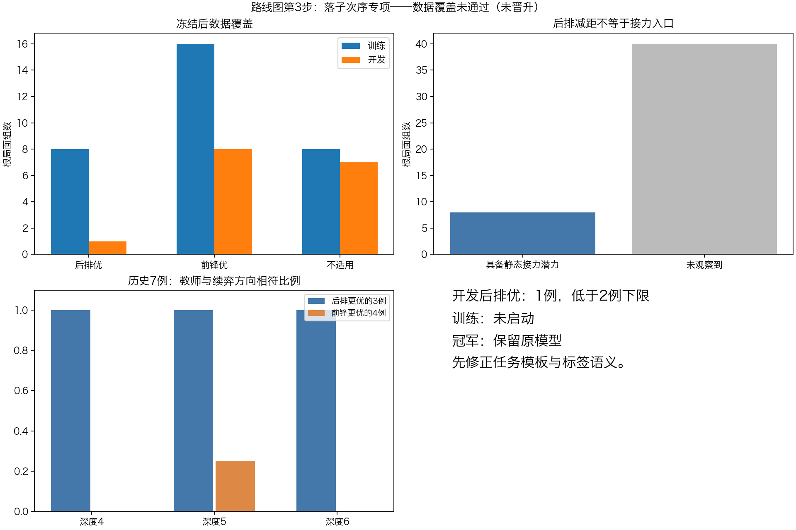

# 路线图第3步：新根落子次序专项

**结论：数据覆盖门槛未过，未启动训练；同时查到几何模板和教学目标尚未对齐。原v3、冠军注册表与GUI保持不变。** 本轮运行已结束，无后台采集或训练。

## 已完成的实际工作

- 固定seed111081生成48个新根，预先分32训练/16开发；双方各24根，根总手数36/49/60/73各12根。
- 排除286164个历史保守几何轨道；48root及96个候选child无历史/跨组重合，48个8手anchor单独检查。
- 全部48根与两候选先冻结schedule，再进行192次固定深度4/5评分。每次实际child搜索深度3/4、未中断、分数反号均审计通过；两child均非终局。
- 根与标签采集耗时212.3秒，pipeline213.5秒。训练尚未开始，所以没有候选模型或模型开发准确率。
- 额外做了一次预声明5分钟上限的历史教师核对：7旧根×两动作×深度4/5/6，共42查询，实际5.9秒。没有新整局对战，没有修改新根标签。

## 为什么没有训练

数据门槛在生成前固定：有效训练至少16根、开发至少8根；后排优/前锋优各自至少训练4根、开发2根。

|划分|后排优|前锋优|有效合计|屏蔽|
|---|---:|---:|---:|---:|
|训练32根|8|16|24|8|
|开发16根|**1**|8|9|7|

总量通过，但开发后排优仅1根，未达到2根。按原配置停止，不换划分、不补当前批次、不放宽差距阈值，也不拿旧7例补开发。因此本轮是**数据阶段未通过，NN没有进行更新**。

15个屏蔽根中：深度4同分3、深度5同分1、两深度方向翻转4、同号但深度5绝对分差仅1的7例。开发另有1个两深度都偏后排的根，但深度5分差只有1，按原门槛屏蔽，没有为凑类别恢复。

## 查到的设计问题

### 1．把“接力机会”简化成了“最后一子距离变短”

这是本轮主代理的任务定义不足。rear规则只要求最远棋子到目标尖端距离减少；front选择前进最多的至少2跳连跳。前者没有直接保证接力入口存在。

48个rear候选中：9个本身就是多跳，33个为邻步；只有8个在走后具备同一棋子继续前进至少2跳的**静态接力潜力**。该检查未走对手，所以不保证下一轮仍可走。这8根的标签为后排优3/前锋优3/屏蔽2，开发中后排优仍为0。

所以这批数据准确名称是“后排减距动作与前锋前进连跳的排序”，不能直接说已经收集到48个“小步接力时机”题目。下一轮应先把接力入口、后排通路和待办先后关系定义清楚。

### 2．几何两候选均存在，不保证两种偏好均衡

前锋候选的平均眼前前进约4.17格，后排约1.90格；这是两类动作属性，不是两类正确答案。开发P1有效6根（后排1/前锋5），P2有效3根（全部前锋）。

此外，P1固定在ply36/60，P2固定在49/73，玩家与具体时间段绑定。双方数量相同仍不能独立区分阵营与阶段影响。下一轮应按邻近手数组成阶段桶，给每个阶段覆盖双方，而不是用一组偶数时间点和另一组奇数时间点分别代表两方。

### 3．“教师局部分数”和“固定续弈结果”是两种监督目标

在历史7个方向较稳定的正反案例上，分别查询固定深度4/5/6的同根两动作分数，结果如下：

|教师根深度|与旧续弈偏好相符|3个后排胜例相符|4个前锋更优反例相符|
|---|---:|---:|---:|
|4|3/7|3/3|0/4|
|5|4/7|3/3|1/4|
|6|3/7|3/3|0/4|

增加到深度6没有把这批分支结果方向统一起来，不据这张表挑“最好深度”重试。把当前深度4/5稳定、差距至少2的过滤套到7个历史根，仅4根适用，其中2根符合旧续弈、2根方向相反；稳定性过滤本身没有保证目标对齐。

这些历史动作本来经过专家分叉筛选；固定续弈又只是特定后续策略的结果。二者都不是最优博弈证明。这张表说明：**模仿当前教师的搜索分数，不能同时当作已经学会了那些续弈胜负差异。** 不能因为连续两个深度同号，就把标签解释为实际胜率或普适棋理。

## 下一步应如何修正

先不启动第二轮参数或数量扫描。保留这48根作为已看诊断集、24个有效训练对作为原始资料，旧冠军不动。

1. 将目标明确拆开：若目标是模仿固定教师，就使用相对评分并按教师一致率验收；若目标是修正长期接力失误，就需要对应的续弈/接力证据及反例，不能混用两种标签后宣称赢棋能力提高。
2. 先为“后排进入接力链、前锋长跳待办、对手改变入口”定义可重放检查的机制条件；静态能连跳只作一个特征，不当作必优标签。
3. 再为全新根冻结阶段×玩家分层、有限收集规模和标签规则。当前16开发根已经用于诊断，不在它们上补调或重新分组。
4. 完成目标/标签核验后才运行已经写好的固定训练器。专项排序通过后，还需要验证实际全合法走法选择及NN搜索；当前不进入整局晋升。

## 训练器已经实现，但本轮未执行其优化路径

单配置原计划2000更新：全共享CNN及策略头训练，value.*参数冻结；成对softplus损失+.5旧合法策略KL+.1旧value输出保留。每批16根从全部eligible train组均匀有放回抽，旧train8/普通train8。value参数冻结不代表共享CNN更新后value输出不变。

新开发仅v3基线与固定终点各一次；过程只看训练。局部开发门槛包括双方向准确率、balanced accuracy较v3增益、pair CE、教师分差惩罚，以及旧策略/价值保持。没有训练，因此没有填造这些模型指标。

原config的sampling文字“16个有效train组”指代不清，执行后只修改源码描述为“每批16根从全部有效train组抽样”；原config、源码快照、原数据、门槛和结果保留。实际抽样代码始终是rng.integers(len(train),size=16)，本轮没有走到此处。

## 审计、测试与工件

- 本机193项单元测试通过；干净检出重建后193项完成，4项可选数据依赖跳过，其余通过。训练损失、开发拒绝、mask0、canonical双方索引、真实重复历史、深度审计与指标门槛均有测试。
- 独立数据审计通过：48根/96child/48anchor、所有前缀、几何选择、192深度记录、分数符号、label/gate和冻结SHA均正确。
- data_review和evaluation_audit分别复核模板特征与标签、开发门槛阻断。历史教师探针另有逐查询审计，不混入48根。
- 原v3 SHA a0a40208061aaaa45931131f1760bb20ae114388c6ae6ad29181b204565395d9保持不变；registry与native哈希未变。没有改动C内核，没有修改GUI，没有模型晋升。

主要工件：collection/保存48根及全部标签；data_audit.json保存结构检查；history_manifest.json保存历史覆盖清单摘要（完整轨道列表留本机）；executed_source/保存实际执行源码（native二进制留本机，哈希在配置）；historical_teacher_probe/保存42次历史教师评分；中文日志、独立复核和验证记录均保留。

有本机冻结源数据及原v3时可用diagnostics/audit121_order_data.py复核collection。收集/训练器输出目录必须不存在；新克隆缺少本机历史轨道清单时不能跳过历史检查直接将结果称全新验证。
