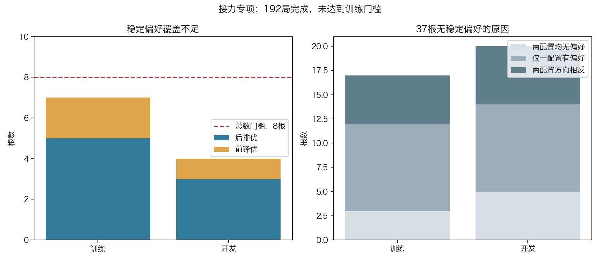
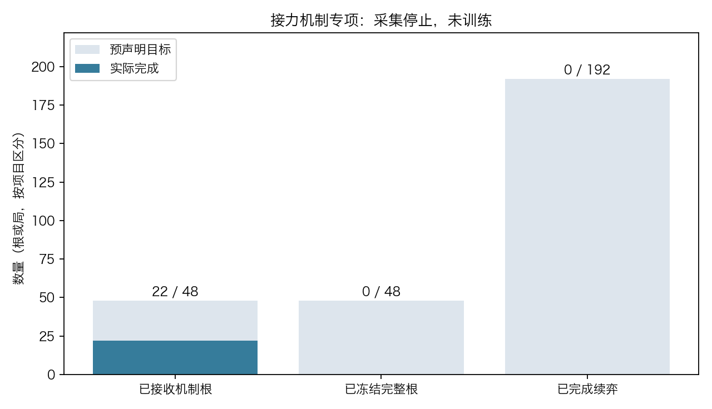

# 接力机制与真实续弈收益专项：恢复完成，训练覆盖不足

路线图第3步，2026-11-06。合盖中断得到诊断后，按[恢复方案](recovery.md)在新目录完成48根、192局真实续弈。**train仅7个稳定偏好根，未达到预声明至少8根，本轮不训练、不补根、不重分、不晋升。**现役v3保留，没有棋力升级结论。



## 恢复证据与执行

系统电源日志记录21:50:52 Clamshell Sleep，持续1001秒，22:07:33 DarkWake；原失败归档mtime22:07:33.93。同一失败局面与完整历史、相同120秒/depth3配置重放，0.01256秒完成、5174节点、aborted=false，见[复现原件](resume_artifacts/failure_reproduction.json)。这强烈支持合盖休眠触发原生截止保护，不能将原中止归为模型或标签质量失败。

新入口PID31323，collector31325，输出本机`nn_checkpoints/experiments/relay121_returns_20261106_resume1`，只执行一次。原22根与历史排除直接复用、逐根重验；从未完成group22的attempt0继续。未改变种子、候选上限、机制、split、两续弈深度、训练配置与验收门槛。原collector211.124秒和原父212.445秒计入累计预算；总流水线累计460.113秒（Python monotonic）。防空闲睡眠caffeinate绑定父PID，随实验结束退出，不能阻止合盖休眠。

## 固定结果

|项目|训练|开发|
|---|---:|---:|
|冻结根|24|24|
|稳定后排优|5|3|
|稳定前锋优|2|1|
|有效总数|7|4|
|两配置均无偏好|3|5|
|仅一配置有偏好|9|9|
|两配置方向相反|5|6|

训练要求有效>=8、两方向各>=2；本轮总数7失败。开发要求有效>=8、两方向各>=2；本轮总数4且前锋优1失败。训练未就绪，因此没有v3开发基线、优化器、候选checkpoint或模型指标；不是模型训练失败。历史7例回归因无最终候选不运行。

192局全部真实结束：170局all_pieces_in_goal、22局equal_turn_goal_draw，无max_ply。96个“根×配置”比较里point偏好43、tempo偏好19、无偏好34；最终11/48根两配置非零同向。其余37根是18根仅一配置有偏好、11根方向相反、8根两配置均无偏好，均保留原件，不把它们删去冒称数据集更可靠。

这说明几何接力机会能被稳定构造，但在本轮两套固定续弈策略下，它与长期动作收益的联系仍稀疏且依赖配置。不能把静态接力证据等同于应优先走后排，更不能用下调门槛1根的方式开启训练。下一步仍是步骤3：先利用本轮归档诊断接力机会在对手应对后是否保留、两深度偏好为何翻转，形成新生成前可观测机制与独立新协议，再决定是否另开实验；本轮数据不补根/重分/重考。

## 独立完整审计

[独立审计结果](resume_artifacts/independent_data_audit.json)：48根、192局、9792个非forced搜索步全量重放/深度审计通过；52项源码/输入SHA及collection manifest核验通过。旧22根逐值等于新schedule前22根、历史文件字节一致，预算来源和恢复工件hash一致。标签由独立逻辑重新计算，train/dev readiness与runner一致。

输入历史/跨组重叠0，mask0。完整续弈共有9377轨道，其中202与历史共享、60跨split共享；这些没有触碰另一split输入root/child，不触发协议mask。**输入隔离不代表所有未来轨迹独立**，不声称搜索最优。

```sh
/Users/liuzirui/miniconda3/envs/checkers/bin/python diagnostics/audit_relay121_returns.py --experiment nn_checkpoints/experiments/relay121_returns_20261106_resume1 --out nn_checkpoints/experiments/relay121_returns_20261106_resume1/independent_data_audit.json
```

新增4项恢复测试，修后全项目215项本机测试通过（4.105秒）。独立审查确认训练固定配置未改；本轮没有训练，抽样/value冻结与模型门槛审计不适用。未改C内核，不重编译。

## 保存范围

[runner原结果](resume_artifacts/result.json)、[恢复配置](resume_artifacts/config.json)、[逐根标签摘要](resume_artifacts/return_summary.json)、[轨迹共享统计](resume_artifacts/collection_trajectory_overlap.json)、[工件SHA清单](resume_artifacts/artifact_manifest.json)和中文日志公开保存；[执行源码](resume_artifacts/executed_source/train121_relay_returns.py)独立快照保留。原192局、完整dataset与36MB历史排除留本机，未强加Git。没有模型产物。现役v3 checkpoint和registry最终校验保持不变。

---

以下保留首次中断的原报告，按当时事实记录；当前结论以上方恢复完成结果为准。

# 接力机制与真实续弈收益专项：采集异常停止

路线图第3步，2026-11-06。单次执行既定入口后，候选推进搜索未完成预声明深度，收集器拒绝继续。**未训练、无候选、无开发验收结果，现役v3保留**。本轮没有棋力升级证据。



## 执行与结果

接手时main工作区干净，HEAD为497cfec；无本项目采集/训练/竞技进程，目标实验目录不存在。预检记录的9个源码SHA全部一致，冠军SHA为`a0a40208061aaaa45931131f1760bb20ae114388c6ae6ad29181b204565395d9`。交接提交已经成功push。

按[原协议](protocol.md)仅启动一次train121_relay_returns.py，主PID26557、collector PID26562。未另起collector，未改CNN、strict121规则或C内核。父进程记录212.445秒，收集器记录211.124秒；这些是各自time.monotonic差值，不据此反推墙钟运行时长。

|项目|实际结果|
|---|---|
|历史排除轨道|288729|
|已接收机制根|22，均为train；ply40/41各6根，56/57各5根|
|48根schedule冻结|未完成，只有schedule_partial.json|
|完整续弈|0 / 192|
|dataset、标签、覆盖判定|未生成|
|训练、开发基线、候选评测|均未开始|
|历史7例模型回归|无最终候选，不运行|

失败现场为P2、ply35，requested_depth=3、depth_reached=2、aborted=true、nodes=5057。ConsistentExpert抛出fixed-depth incomplete，父进程随后以CalledProcessError终止。原生搜索有单次120秒截止保护；现有归档足以确认深度未完成，**不足以判定具体为何触发中止**，不将它归因于标签、模型或数据覆盖失败。原始[失败局面](artifacts/fixed_depth_failure.json)、[收集状态](artifacts/collection_status.json)、[主状态](artifacts/status.json)保留。

没有跳过失败候选、补根、重分split、放宽深度或重复启动。本轮在训练覆盖判断之前结束，因此不能写成“覆盖不足未训练”。下一步仍是步骤3：先针对归档现场诊断搜索中止来源，再明确新的执行/恢复边界；现有目录不得直接重跑或覆盖。

## 独立复核

独立审计脚本不调用生产prepare_rows或stable_preference。对已接受22根逐一重放完整prefix，检查root/child/anchor轨道、前进邻步后原合法走法不可达的新多跳末点、前锋连跳、历史及跨组输入排重，全部通过；输入历史/跨组重叠为0。[独立审计结果](artifacts/independent_data_audit.json)。

```sh
/Users/liuzirui/miniconda3/envs/checkers/bin/python diagnostics/audit_relay121_returns.py --experiment nn_checkpoints/experiments/relay121_returns_20261106 --out nn_checkpoints/experiments/relay121_returns_20261106/independent_data_audit.json --partial
```

未产生192局，故终局标签、逐步深度、跨split续弈碰撞和训练抽样审计均不适用，不宣称它们通过。独立脚本完整数据分支尚无本轮数据可验证。

## 执行后修复与工件

只读审查另外发现runner调用old_metrics却漏导入，若未来进入基线评测会NameError；此次实际失败发生得更早。执行后补充`from unfreeze121_trial import metrics as old_metrics`，名称解析检查通过，不改预算、训练目标或门槛。未用修后源码重新运行本轮。原执行源码保留在[executed_source](artifacts/executed_source/train121_relay_returns.py)，与当前修复版本明确区分。

[事后失败摘要](artifacts/failure_summary.json)不是runner生成的result.json（后者不存在）。[完整本机工件清单](artifacts/artifact_manifest.json)记录执行源码、历史排除、部分根、原生依赖与错误归档SHA；大历史轨道、模型和原生二进制留本机。公共工件保留部分根、配置、执行源码及错误证据。现役registry与checkpoint最终再核验不变，无实验后台进程。

修复后验证：211项本机unittest全部通过（4.137秒）；旧评测导入身份检查通过，独立训练审查确认配置与门槛吻合协议。测试结果不代表训练完成或棋力升级。
