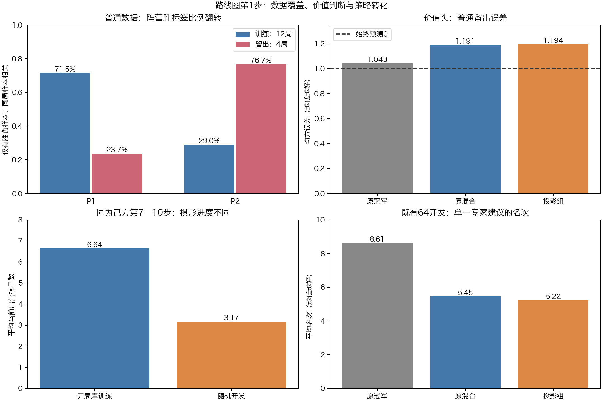
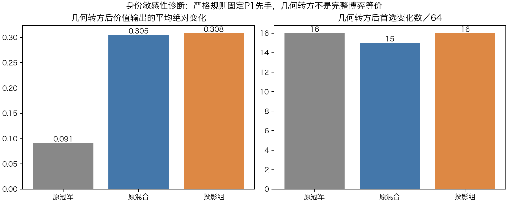

# 路线图第1步：数据、目标、价值头和策略转化诊断

## 结论与当前阶段

**第1步已完成；优先问题是价值信息不足、独立对局少且阵营结果分布跨组变化，以及训练与开发棋形/教师目标不同。停止继续调梯度技巧，下一步进入第2步补充和重建专家数据。**

本轮只读取既有数据、固定模型和已经评分的动作；没有训练、教师查询、新对局、模型选择或晋升。沿用原v3，三个子代理分别审查数据覆盖、价值头和策略转化，主代理追加身份语义检查并整合。既有64根是事后机制诊断对象，不是再一次独立验收。



## 1．价值头目前缺乏跨来源稳定的局面判断能力

|留出数据|模型|MSE↓|常数0基线|符号准确率|预测与结果相关|
|---|---|---:|---:|---:|---:|
|旧653|v3|1.010|1.000|49.0%|−0.026|
|普通353|v3|1.043|1.000|40.2%|−0.257|
|普通353|原混合候选|1.191|1.000|23.5%|−0.506|
|普通353|投影候选|1.194|1.000|23.5%|约−0.506|

v3旧留出输出0.002±0.075，数值大多接近0；近期候选输出标准差扩大到约0.16，留出误差反而增加。输出饱和比例均为0。旧真实终局前16手112例也只有MSE1.006、相关0.096，没有跨来源稳定有效的阶段。

早期真实±1只是某条对局的最终结果，不代表每个局面都应被确定预测为胜负。这里以零值、训练均值、分阶段/阵营训练先验作基线，检验模型是否确实提供额外信息；连续棋谱样本有关联，不把653个局面当653场独立比赛。

标签逐构造核验通过：5129个旧样本、1398个普通样本的z均为当前走棋方视角；canonical仅改坐标不改z。当前MCTS代码也以当前走棋方值展开并逐层反号，约定与这些标签一致。本轮未运行新的MCTS对战，不能把整局失败只归因于价值头。

完整结果：[value.md](value.md)、[value.json](value.json)。

## 2．总体正负平衡掩盖了阵营与对局来源偏置

普通数据只有12盘训练、4盘留出：训练P1胜7、P2胜3、真实等轮和2；留出P1胜1、P2胜3。按有胜负样本统计：

|玩家|训练胜标签比例|留出胜标签比例|
|---|---:|---:|
|P1|71.5%|23.7%|
|P2|29.0%|76.7%|

总体z正负数量接近平衡，但分玩家后方向反转。v3在普通训练和留出上都保持P1价值均值约+0.04、P2约−0.04；普通训练总体相关0.210，拆P1/P2后只有0.032/−0.008。说明当前统计上的“相关”主要含阵营先验，局面内的区分很弱。候选放大这种输出后，在角色结果相反的留出组更差。

这是当前小规模棋谱的实际分布，不是P1或P2真实长期胜率。后续按开局组分配、交换引擎配置所在阵营，并扩大独立对局来源；不事后挑胜负来修饰开发集。

普通训练1045条里182个z=0全部来自2盘真实`equal_turn_goal_draw`，权重1；没有max_ply。旧加载器却将训练7盘真实和棋（671条路径）、旧验证1盘真实和棋（87条路径）整体排除。后续新数据版本应统一真实和棋语义，保留历史原件和旧实验可复现性。

旧训练有86组同棋盘/走棋方出现不同真实结果，记录为结果多样性；相同棋盘在不同历史和后续策略下有不同结果，不直接判成污染。全文和阶段表见[coverage.md](coverage.md)、[coverage.json](coverage.json)。

## 3．训练与开发的棋形分布落差很大

|同为己方第7—10步|记录数|平均当前出营棋子|平均前向纵坐标|
|---|---:|---:|---:|
|开局库训练|348|6.64|−3.37|
|旧库留出|104|6.73|−3.32|
|随机开发根|64|3.17|−5.31|

随机开发根明显更滞后，离专家开局树棋形更远。按相同步数分组不足以消除这个分布差异。

原565库训练记录按保守几何分组只有234组；这些组不是严格独立棋力样本，不能仅靠镜像扩增数字判断数据规模充足。第7—10步库训练P1有160条、P2有188条；旧普通该段双方各148条/106精确局面，新普通双方各48条/48局面。后续应补离库、滞后开局及中盘的真实专家轨迹，而不是继续重复同一批库局面。

训练目标是原开局库推荐集合；随机开发用固定depth5的121格Clysto评估派生搜索。教师定义不同是已知设定。由于没有同局面的双教师完整对照评分，本轮没有证明两者具体偏好冲突，不能把目标定义差异直接写成标签错误。数据源、目标定义和指标应分别保存、分别评测。

## 4．策略学习并非毫无作用，但额外增量很少跨过首选边界

既有64根的单一专家建议平均名次从v3的8.61变成原混合5.45、投影5.22；概率从14.88%变成16.80%、16.92%。这说明建议确实被往前推。

投影相对原混合，有43/64例单建议概率上升，其中40例首选未变，最终只改变3个首选。那些动作的已存专家分差是9→14、2→0、3→0，改善与恶化恰好抵消。因此不能把“概率上升43例”写成“43例棋力提升”。

整体训练命中从原混合256/565变成投影268/565，多12例；但第7—10步合计139/348变成138/348，反少1例。额外命中主要没有落在后段瓶颈上。单建议命中13/18/20，与允许所有实际同分动作的专家同分21/23/25分开报告。

原冻结192个模型首选在事后forward中全部重现，未查询新的动作分数。详见[transfer.md](transfer.md)、[transfer.json](transfer.json)。

## 5．身份平面的语义：更正此前“完整对称”表述

主代理构造真实几何旋转180°并交换颜色/走棋方的配对。1635个既有局面均验证：canonical后0/1/2/4/5平面逐值相同，只有第3身份平面改变，合法canonical动作集合相同；使用固定动作顺序避免同分排序干扰。

在既有64根上，身份切换后的平均价值绝对变化为v3 0.091、原混合0.305、投影0.308，首选变化16/15/16例。这证明模型对身份信息敏感。

**但strict规则固定P1先手，等轮判和也有角色差异，所以几何转方不是完整博弈等价。** 已保存可复算反例：原局面P1全部入营、P2差一子且可走15→6，规则判等轮和；几何转方后判P2获胜。身份信息具有真实语义，不能据输出差直接认定编码bug、删除身份平面或自动交换胜负标签。

前轮把旋转换色称为完整规则对称的说法不准确，现已更正。继续用它作保守数据隔离，不会引入相同/相近棋形跨组；但“旋转换色跨组”不能与完全相同输入泄漏等同。旧128及64已被多轮分析，不作全新独立终验。



机器结果及终局反例在[identity.json](identity.json)。新增回归测试明确保存这个规则边界。

## 问题优先级与第2步计划

1. **先重建价值监督的独立对局来源与覆盖。** 目前主要依据12盘新训练、4盘新留出来判断近期价值变化，样本条数掩盖独立对局少；应按开局组和引擎角色组织，保留自然开发结果。
2. **统一新数据语义。** 胜+1、负−1，真实规则和棋0且weight1；max_ply未完局不伪造胜负，若保留策略样本则value_weight0。先手与终局规则保持不变。
3. **补充离库和滞后棋形。** 保留开局库作明确来源的策略监督，另收固定深度派生专家的新轨迹，覆盖当前缺少的阶段和棋形；不混写两个教师的准确率。
4. **阶段3再检验信息增益。** 在新独立对局上先比较价值头与零值/训练先验，检查真实终局附近能否稳定区分，再看策略保持和MCTS效果；不继续扫投影系数。

有限试点建议：16个新训练开局组、8个新开发组，各交换两个固定引擎配置所在阵营两局，共48局。保留P1先手，不旋转换色伪造对局；配置、分桶、种子和预算在运行前锁定。步骤2只收集和审计，不直接训练或晋升。完整路线图见[TRAINING_ROADMAP_121.md](../../TRAINING_ROADMAP_121.md)。本轮未启动这48局。

## 验证与复现

本轮新增4个只读诊断工具、中文绘图及测试；三子代理独占文件范围协作，没有重复训练。既有模型、注册表、规则和C内核未修改。157项本机单元测试通过；暂存区干净检出构建C内核和分析专家后157项完成、4项可选数据依赖跳过、其余通过。

本机含原模型和数据时可复算：

```sh
python diagnostics/diagnose121_coverage.py --output docs/experiments/roadmap121_step1_20261105/coverage.json
python diagnostics/diagnose121_value.py --output docs/experiments/roadmap121_step1_20261105/value.json
python diagnostics/diagnose121_transfer.py --out docs/experiments/roadmap121_step1_20261105
python diagnostics/diagnose121_identity.py --output docs/experiments/roadmap121_step1_20261105/identity.json
```

绘图用带matplotlib的Python执行`diagnostics/plot121_step1.py <报告目录>`；诊断模型用checkers环境。源码/输入/模型SHA分别随JSON保存。数据表、逐例记录和中文图公开；模型不随提交上传。
