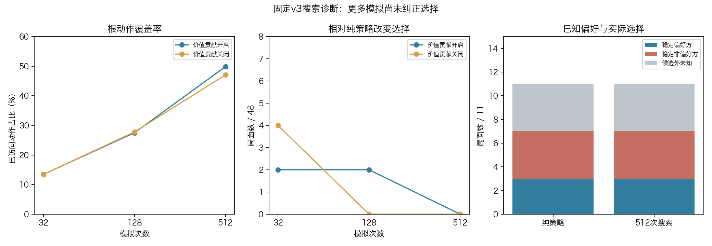

# 固定v3搜索链路诊断：未发现反号错误，搜索纠错收益未显现

路线图第3步故障诊断。2026-11-06 23:58启动，2026-11-07 00:00结束（北京时间），目录沿用20261106标识。用户授权排查搜索。无训练、无冠军切换，不是第4步候选达标或新独立棋力验收。

**结论：当前NN搜索链路确实没有在这批诊断局面中发挥明显纠错作用，但没有发现“价值反号/终局规则写错”的确定性实现错误。仅增加模拟量没有解决问题。** 固定v3的价值判断、策略先验集中程度和搜索计算效率需要一起检查，不能只把失败归结为训练量不足。



## 固定方案与正确性

[预声明协议](protocol.md)：现役width32 CNN/strict121，固定48个已看relay机制根；纯策略全合法argmax，对比32/128/512模拟各价值贡献1与0共288次搜索；不扫描系数、不挑配置、不训练。输入已用作诊断，不能称全新独立验收。根覆盖的是中局40/41/56/57手，结论不能外推整个开中残局。

新增8项独立测试，以可穷举有限树检查2/3层反号、对手选择、精确访问/回传守恒、终局胜负和棋、重复与限步覆盖NN估值；真实strict局面检查P1末步equal-turn draw与P2末步胜优先于重复/限步。测试不证明有限预算PUCT普遍等价minimax。全项目223项本机测试通过（3.924秒）。[独立代码审查](independent_review.md)没有发现确定性的反号、终局优先级、历史串扰或canonical动作映射错误。

生产搜索只增加观测字段和可选time_limit=None。默认仍按固定模拟量运行，探索常数、先验、FPU、价值回传、选招方式不改；默认输出不引入非确定耗时字段，原显式/默认配置一致测试通过。现役注册表与GUI未修改，C内核未改。

## 48根实际选择

|模拟数|价值贡献|单根平均耗时|平均根动作覆盖|相对纯策略改变选择|平均模拟深度|
|---:|---:|---:|---:|---:|---:|
|32|1|22.01毫秒|13.44%|2/48|2.309|
|32|0|21.57毫秒|13.42%|4/48|2.306|
|128|1|88.32毫秒|27.52%|2/48|2.813|
|128|0|92.30毫秒|27.79%|0/48|2.817|
|512|1|372.53毫秒|49.89%|0/48|3.328|
|512|0|373.38毫秒|47.08%|0/48|3.350|

合法动作数48～91、中位66。开启价值贡献时，32/128/512平均访问8.52/17.48/31.94个不同根动作。**512次搜索在全部48根上与纯策略选择相同，关掉非终局价值贡献后也一样。**这支持本轮搜索主要跟随策略先验、没有产生可见选招纠正；不能证明这些纯策略选择都错，也不能证明搜索在所有其他局面无效。

开启价值贡献时，已访问根孩子Q极差的中位数仅0.01189/0.01385/0.01741；原根NN价值在−0.08917～+0.04794之间。Q的变化小与“缺乏足够差异信号”相容，但不能据此单独证明价值头因果责任；访问分配和不同搜索深度也影响Q。没有扫描探索常数或换一套价值尺度重考。

原48根中仅11根有两套真实续弈同向偏好。纯策略与全部6组搜索配置的实际选择均为：3根选稳定偏好方、4根选稳定非偏好方、4根候选外未知；原pair按访问数排对4/11（tie不正确）。这不是全合法走法准确率，更不是胜率。4个候选外动作没有新续弈标签，不能算好或坏。[逐根原件](artifacts/cases.jsonl)。按原train/development拆分结果保留在[result](artifacts/result.json)，不选择最优split或检查点。

特别注意：value_scale=0只关闭非终局NN估值，仍保留真实终局±1/0；现有MCTS不对两条都胜路线的落子数差直接赋奖，而本轮11偏好可含tempo目标。因此不能把所有tempo偏好未命中解释成搜索规则错误。

## 12局近似同时间实战诊断

固定前6根，各交换NN阵营两局，保留原prefix/走棋方/重复历史；没有按结果挑开局。对手是**Clysto评估派生121，不是原版完整Clysto**。NN最多100000模拟并设0.1秒软截止；C派生max_depth62、0.1秒。两边都按真实strict终局或max240归档。

结果：**NN 0胜12负，无和棋、无截断**。只说明本小批已看中局在此配置下明显落后，不是新独立冠军挑战，也不据12局计算普适胜率。

|实际think统计|NN|Clysto派生|
|---|---:|---:|
|落子次数|302|308|
|平均墙钟|103.50毫秒|99.84毫秒|
|平均CPU|103.15毫秒|99.56毫秒|
|最长墙钟|155.51毫秒|100.47毫秒|
|超过110毫秒|23手|0手|
|计数中位数|151次完整模拟|43856.5原生搜索节点|

两种计数含义不同，不能据此声称搜索效率差某个固定倍数。NN在模拟边界检查截止，至少完成一次，展开本身可能超时，所以这里只称近似同时间/相同接口软预算；NN实际平均还略多用时间，仍未取胜。[12局全部路径与逐手审计](artifacts/games.jsonl)。本轮未增加纯策略实战臂，不能由0-12推出MCTS实战一定比纯策略差。

## 独立复核与保存

[独立审计](artifacts/independent_audit.json)检查288cases、重算48次纯策略、独立复算11标签来源、重放12局610手，访问计数/根覆盖/归一化/实际argmax/根方Q/预算汇总及12项输入源码native/模型registry hash通过。不重复MCTS搜索；最大深度只按归档范围和摘要复核，不冒称重建内部搜索树。

```sh
/Users/liuzirui/miniconda3/envs/checkers/bin/python diagnostics/audit_search121_diagnostic.py
/Library/Frameworks/Python.framework/Versions/3.10/bin/python3 diagnostics/plot_search121_diagnostic.py docs/experiments/search121_diagnostic_20261106
```

原件留本机`nn_checkpoints/experiments/search121_diagnostic_20261106`，公开[工件清单](artifacts/artifact_manifest.json)、配置、288记录、12局和执行源码；模型和原生二进制不提交。主实验累计112.461秒。现役v3 checkpoint SHA保持`a0a40208061aaaa45931131f1760bb20ae114388c6ae6ad29181b204565395d9`，未训练、不晋升，实验与防空闲睡眠进程已结束。

## 下一步判断

应先验证“搜索能否利用有区分度的叶子评价改善选择”，再继续投入专项训练。可在另行冻结协议中保持CNN策略先验与预算，比较NN叶子价值与固定手工评估叶子价值，并列出纯策略实战对照，拆开估值信号与搜索机制的责任；不能仅把模拟量从32加到512就当作修复。也不能直接修改冠军配置或凭已看局面选择参数后宣称棋力升级。
