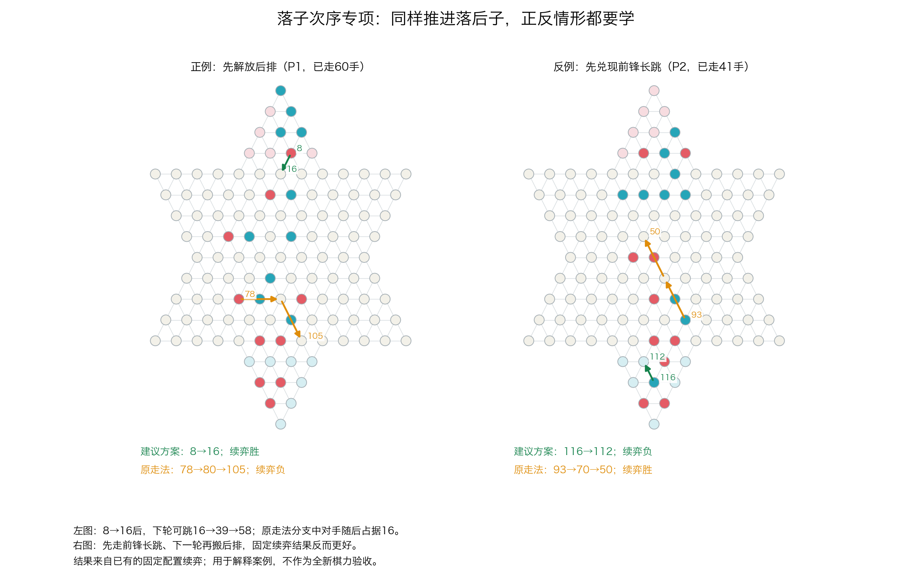

# 路线图第3步：落子次序专项复盘

**完成日期：2026-11-06。已定位一项具体能力缺口：后排一步接入跳链与前锋现成长跳，应该谁先走。** 本轮完成只读复盘、正反例整理和下一轮任务定义，没有训练、教师搜索、新对局或模型晋升。

## 一个可以看清楚的失误

历史seed13，P1已走60手，最后一枚仍在出发营的棋子位于8：

|方案|当前动作|下一次对方动作|下一次己方动作|已有固定续弈结果|
|---|---|---|---|---|
|先解放后排|8→16|79→60→41|16→39→58|P1胜|
|先走前锋长跳|78→80→105|79→60→41→16|8→17|P1负|

先走8→16看起来眼前推进少，但它让最后一子进入下一段跳链。先让前锋长跳，对手随后占据16，后排改走另一条路线。这里的关键是**接力机会和落子时机**，不是当前一步跳了多远。

原v3把先解放后排的动作排第5，概率7.79%；前锋长跳排第1，概率13.37%。两个后继局面换算成根方视角的NN价值分别0.02120和0.02406，价值头也排反。两局面处于相同手数、同一走棋方，因此这个局部排序错误无法靠单纯改变P1/P2平均预测修复。

两条完整续弈说明这是一例值得学习的时机选择；它们没有单独隔离出“占据16”是唯一原因。保存全部后续路径，后续可对照检查。

## 同时必须学会反例

seed40的P2局面同样存在后排小步与前锋长跳，但正确次序恰好相反：

- 建议方案116→112，下一己方步93→70→50，固定续弈P2负。
- 原走法93→70→50，下一己方步116→112，固定续弈P2胜。

所以不能加入“后排越落后越优先”的通用奖励，也不能因为动作来自expert就赋予更高标签。专项应比较两个具体方案的先后次序，正反上下文都要覆盖。



## 全部历史对比的结果

本轮没有只挑上面两例：读取全部13个既有根，重放52条固定续弈记录，并对照更早的另一套续弈结果。

|类别|数量|seed|用途|
|---|---:|---|---|
|两套续弈都支持建议方案|3|9、13、47|历史正例|
|两套续弈都支持原走法|4|12、31、40、44|历史反例|
|两套续弈排序方向翻转|1|18|续弈敏感性检查|
|复查两分支同负|3|17、36、39|不能给严格优劣标签|
|两个根动作完全相同|2|11、35|实现一致性对照|

3个正例中，v3策略头全部更偏向前锋原走法，价值头也有2例排反。4个反例中，策略头全部偏向原走法，价值头3例方向正确。合计7例策略/价值各4例正确；始终选原走法的简单基线也是4/7，不能把4/7称为有用专项能力或独立准确率。这批根是历史筛选案例，不能推断这种失误在所有对局中的发生比例。

同一根比较后继局面，两个输入的走棋方相同、手数相同，检查的是局部差异。这比拿两种阵营各自的平均胜率比较，更接近我们真正希望价值头或策略头学会的东西。

## 为什么过去的一些纠正没有效果

1. **标签过于宽泛。** rear_lag只描述建议动作缩短了最后一子到目标尖端的几何距离，不保证这个动作更好。这里有4个跨续弈设置方向稳定的反例。
2. **发现的不同动作不等于失误。** 13根中有同负、方向翻转和完全同动作，不能全部塞进严格偏好损失。
3. **监督整个对局的胜负，难以指出这两个方案的区别。** 当前后继价值差多数只有千分位，seed13甚至方向错误。需要同一局面内的动作比较，明确教它这次应先做哪件事。
4. **旧的局部选种偏晚。** 既有记录中还存在更早的专家分叉；本专项不承担解释所有输棋的任务，也不把每次专家分叉算成一次错误。重新读取40局、1665条已标注NN回合，是为了保留阶段背景。

本轮专家指121格Clysto评估派生搜索，不是原版完整Clysto；策略建议、固定深度配置下的续弈结果和全局最优走法分别记录。

## 下一轮专项应怎样做

目标固定为：**在同一局面中，正确排序“后排接力先走”与“前锋推进先走”两个合法候选方案。** 先检查这个局部判断能否学到，再检查能否改善实际选择。

- **数据：** 另建新的根局面组，建议上限48组，生成前固定32训练/16开发；按出营数量、最后一子进度和阶段分层。完整棋盘、走棋方及保守几何轨道排除历史，不按NN错误或分支赢家挑根，不事后重分。
- **标签：** 每根保留两种合法候选。先用统一、固定预算的派生专家比较强制候选后继的相对评分，清楚标明教师评分语义；终局结果另存。方向不稳定、同分、截断未结束都不伪造严格胜负偏好。实际标签覆盖不足时停止该批训练，不临时凑胜局。
- **训练：** CNN不换架构，先用一套固定预算学习同根动作相对排序，并保留旧策略能力约束。正式运行前将具体参数、数据哈希和验收门槛写入配置，不边看开发结果边改配方。
- **验收：** 新开发组独立统计先走后排与先走前锋两类命中、分组排序误差和旧能力变化；始终后排优先、始终前锋优先及原v3都作基线。不能靠只学占多数的一类通过。通过后再安排NN搜索选择与独立整局确认。
- **历史7例：** 只作机制演示和回归。背会7例不算学会棋理；不作为新开发或冠军晋升证据。

这一步不需要继续给整盘所有局面统一强化±1，也不需要先更换CNN。先保证监督目标确实指向这项局部判断。

## 验证与复现

- 52条已有续弈、40条已有原始对局均合法重放，真实终局及手数相符。
- 26个分支的两次重复路径逐值相同。重复不增加独立样本数量。
- 复查使用max_depth=4配置，旧脚本未保存逐步depth_reached，不补写不存在的每步深度审计。
- 用公开inputs重新运行诊断，result.json与首次结果完全一致。
- 原v3及冠军注册表未改，无训练、教师搜索或新对局。

有SHA匹配的原v3模型及checkers环境时：

```sh
python diagnostics/diagnose121_skill_pairs.py --root docs/experiments/skill121_review_20261105/inputs/targeted --recheck docs/experiments/skill121_review_20261105/inputs/recheck --out /tmp/skill121_review_new_output
```

输出目录须不存在。绘图用带matplotlib的Python执行diagnostics/plot121_skill_pairs.py加本报告目录。result.json含13根棋盘、原模型候选概率/排序/价值及续弈结果；历史回归案例.json不作为自动训练数据。独立复核见continuation_review.md。
