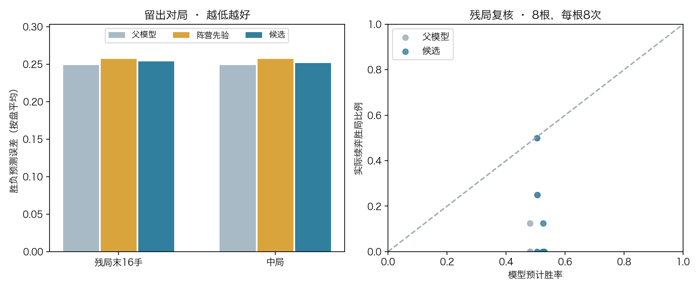

# 冻结走法推荐后的残局胜率复核

路线图第3步，2026-11-07。继承首轮模型，冻结CNN与走法推荐，使用新完整对局只训练胜／和／负头。**残局主指标未通过。** 候选的走法推荐逐值等于父模型，开发残局胜负预测误差从0.249247升至0.253814。

[执行前协议](protocol.md)固定数据、采样、门槛与复核流程。80组新开局在结果产生前冻结，48盘训练、24盘开发、8盘为复核来源。训练与开发72盘全部真实结束，P1胜32、P2胜35、规则和棋5。6767个状态中排除98个历史重复，其中3个也属于跨组冲突。最终训练4446、开发2223。全部数据来自固定父模型的完整对局。

胜率头更新1200步。每步各取8个全阶段和末16手样本，先均匀抽盘再在盘内抽样。独立复核确认完整抽样轨迹和所有非胜率头参数一致。

|留出对局条件胜负Brier，按盘等权|父模型|训练阵营先验|候选|
|---|---:|---:|---:|
|末16手，22盘有胜负|0.249247|0.257153|0.253814|
|中局，22盘有胜负|0.249197|0.257221|0.251951|

残局候选比先验低0.003339，未达0.005改善幅度，较父模型退步0.004567。后手残局误差从0.249448升至0.257898。中局退步0.002754，在预设0.01容差内。残局三类负对数损失从0.977215降至0.939521，三类Brier从0.577512升至0.581401。三类指标与胜负区分结果一同报告。

8个新残局根逐个进行原局面、强制走法A和强制走法B的续弈，每种各8次。192盘均真实结束，其中规则和棋10。原局面共64次续弈，当前方7胜55负2和。候选直接预测平均胜率51.85%，固定续弈下实际胜局比例10.94%。这8根是按进营棋子数选出的残局，经验比例适用于本次续弈策略，样本量有限。

|原局面胜率Brier，按根等权|父模型|候选|
|---|---:|---:|
|网络直接预测|0.239778|0.267192|
|128次MCTS回传估计|0.225791|0.218752|

两招积分差达到预设0.25的局面只有2根。父模型与候选的直接子局面预计积分各排对1根，搜索回传排序和最终按访问次数选择均为0根。父模型与候选的128次搜索首选均落在两招之一。复核输入按完整轨道隔离，后续轨迹仍有33个轨道跨根共享，39个与采集轨迹共享。当前证据不足以确认搜索选招收益。

268项本机测试通过。独立审计逐手重放72盘训练与开发棋谱、8盘复核来源、192盘续弈，验证父模型预测、1200步采样轨迹、留出预测、门槛、冻结参数及13项执行源码哈希。训练入口耗时524.37秒。候选、完整搜索记录和训练张量保存在本机实验目录 nn_checkpoints/experiments/wdl121_head_only_20261107。界面分析继续使用首轮模型，棋手为现役v3。[独立审计](artifacts/independent_audit.json)
