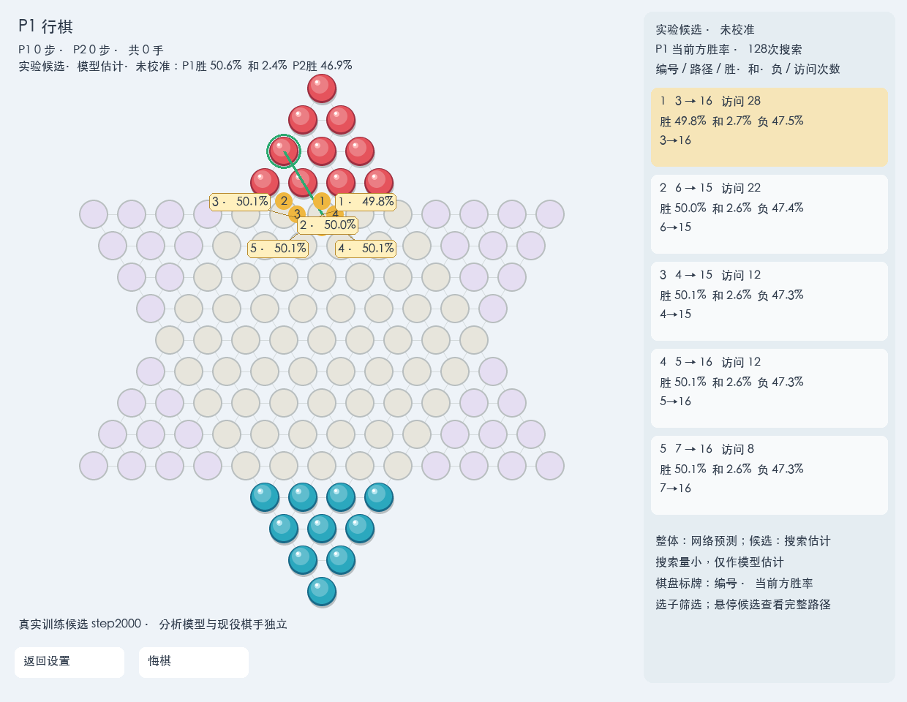
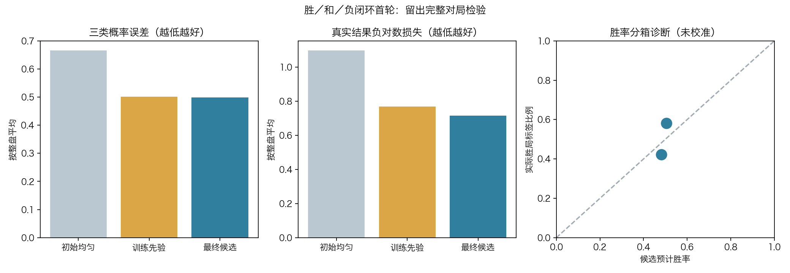
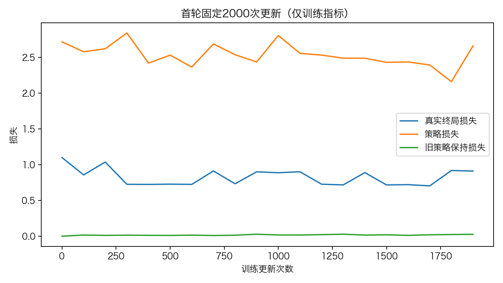

# 胜／和／负学习闭环首轮与前5候选分析

路线图第3步，2026-11-07。已完成“固定模型预测→48盘完整自弈→真实终局纠错→2000次训练→留出概率验证→32盘候选复核”的受控首轮。CNN、strict121保留，现役v3未覆盖，不自动晋升。首轮原型不代表路线图第6步生产迭代已经达成。

**工程闭环与实时分析已经落地；胜率判断仍粗糙，不能把概率指标改善或10胜6负的小样本诊断称为棋力升级。**

## 用户可见功能

GUI扩展右侧分析栏，保留原棋盘与按钮位置。每个完整局面由独立后台WDL模型做固定128次MCTS，显示前5候选（可设3～5）、完整路径、当前方胜／和／负估计和访问次数；编号对应棋盘落点，悬停高亮起点与多跳路线，同末点不同棋子不合并。整体网络预测与候选搜索回传估计分开，始终标“实验候选／未校准”。分析模型不替换棋手。

候选三概率逐层交换胜负方向回传，不把scalar Q换算成胜率；未访问不填数字，限步叶不伪造真实和棋。展示top5不等于搜索只许5招，PUCT仍结合价值、先验与探索分配访问。换局、悔棋、棋盘／走棋方／手数／重复历史改变时拒绝过期异步结果，动画落子后更新。

默认分析指针位于本机nn_checkpoints/experiments/wdl121_loop_20261107/display_model.json，指向run2的真实candidate_step2000.pt。GUI需在checkers Python环境运行；可用CC121_WDL_TOP_K设3至5、CC121_WDL_MODEL显式指定独立WDL checkpoint。旧v3标量模型不能冒充WDL模型加载。

截图使用本轮真实step2000模型；不是初始均匀演示。界面百分比仍是未校准估计。

## 首轮固定方案

[执行前协议](protocol.md)。策略与CNN继承v3，独立新增胜／和／负头，零初始化最后层使初始三类各1/3；旧scalar value参数冻结保留，但新搜索使用pwin-ploss。新checkpoint格式与旧冠军互拒，不修改冠军注册表。

56组新开局在结果前冻结：32训练、16开发、8行为复核。随机合法prefix目标8/9/16/17手，root与8手anchor按保守几何orbit排除完整历史及其他组输入。prefix不训练；旋转换色仅排重，不增强标签。固定初始WDL0双方32模拟自弈；每步root噪声，前12手按访问分布采样，之后argmax，整盘不更新模型。每步保存当时预测、完整合法动作访问目标及实际路径。

训练固定2000步，lr1e-4、AdamW decay1e-4、clip1。每批新16按game均匀再组内sample均匀，旧train8／普通train8仅保持策略KL。loss=新soft-policy CE+新WDL CE+.1旧policy KL(v3)。0/1000/2000保存，不择点；过程每400只看train，开发仅初始和final各一次。真实终局按当时走棋方标胜／和／负，截断无WDL梯度。

## 数据与训练结果

48盘全部真实结束：P1胜27、P2胜20、同轮完成真和1，无限步截断。训练32盘为P1胜18／P2胜13／真和1；开发16盘为P1胜9／P2胜7／真和0。

共4404个非前缀状态，历史排除33，跨train/dev轨迹orbit冲突0；最终train2939、development1432。跨组排除按完整board+player保守orbit执行，不交换身份标签；原始棋谱保留。8组probe输入均未碰实际训练输入，不能据此声称全部未来轨迹独立。

|16盘留出指标，按整盘平均|初始均匀|训练玩家先验|固定最终候选|
|---|---:|---:|---:|
|三类Brier平方和|0.666667|0.501556|0.498577|
|负对数损失NLL|1.098612|0.767713|0.715498|
|预计得分MSE|0.250000|0.246103|0.248835|

训练先验只由train、按实际game均匀目标构造，三类各加1伪计数，不用开发调先验。原预声明开发门槛全部通过，见[原result](artifacts/result.json)。该事实如实保留，但**不把它解释为可靠胜率已经学成**：开发没有和棋，降低和棋概率即可改善三类指标；胜负二分类的补充诊断仍不优于玩家先验。候选在排除和棋后的条件胜率约49.08%～51.90%，二类Brier为0.248443，训练先验0.243728（更低更好）。预计得分MSE也仍稍差于先验。

补充诊断在固定final后计算，仅用于解释，不据此挑检查点、补训或改原门槛。概率校准与胜负区分能力是不同问题；接近五五开的预测可能接近总体频率，却不能有效区分好坏局面。本轮GUI因此仍为calibrated=false。不得在已看16盘上反复调参重考。

## 固定行为复核

另8组预冻结开局，各交换候选阵营，分别对初始WDL0与现役v3，各16盘，双方32模拟、无噪声／额外书库：

|对手|候选胜|候选负|真实和棋|截断|
|---|---:|---:|---:|---:|
|初始WDL0|7|6|3|0|
|现役v3|10|6|0|0|

这是小样本搜索行为诊断，不是预声明独立整局晋升赛；没有C参考挑战，不据此宣称已超越Clysto或完整棋力升级。初始WDL0继承v3策略但价值均匀，不能与现役v3混为一个对手。[全部路径摘要](artifacts/probe_summary.json)。

## 两项预检修复

1. 首入口在旧数据兼容检查结果返回前启动，发现旧policy-only样本有winner/reason而缺player，已在历史预检阶段停止；无schedule／对局／训练。适配器只保留旧策略目标，显式去掉终局字段，不能让旧标签混入本轮WDL。真实旧653／普通353接口检查及回归测试通过。
2. run1历史检查拒绝旧搜索归档：旧读谱器将info.paths候选集合误当连续棋谱。修后仅依据完整搜索元数据结构分类，实际opening+paths仍逐步重放，非法候选元数据仍阻断；同时修直接121根目录分类假阴性。[修复证据](artifacts/history_parser_diagnosis.json)。这属于历史读取正确性，不是NN搜索反号bug。

前两次预检目录与状态保留，没有先前训练数据被重新采集。最终在run2唯一入口执行，保守扣除600秒预检预算；状态累计1143.100秒，其中run2自身约543.100秒（Python monotonic，不把它误称合盖睡眠期间的墙钟时长）。采集／训练／评测均在固定预算内。C内核未改，不需要重编译。

## 复核与保存

新增WDL格式／损失／标签、历史解析、采样、视角、搜索统计和异步GUI测试。执行前262项本机测试通过。独立代理复核56根、48自弈、真实标签、历史与跨split排除、训练2000步trace、0/1000/2000参数、概率指标与32盘行为复核；审计结果随[工件目录](artifacts/)保存，不重复搜索或训练。

本机原件：nn_checkpoints/experiments/wdl121_loop_20261107_run2；模型、samples.pt、完整搜索日志和38MB历史排除留本机，不强加Git。公开执行源码、配置、概率记录、完整实际路径摘要、固定门槛、中文图与哈希清单。执行源码快照保留，后续仅UI增强与训练无关。冠军仍v3，checkpoint SHA为a0a40208061aaaa45931131f1760bb20ae114388c6ae6ad29181b204565395d9。

下一轮应继续同一主线，重点检验“谁会赢”的区分与真实搜索收益，避免仅因减少和棋概率而误判成功；新数据／预算／验收先冻结。首轮当前不继续自动重训、不覆盖冠军。

训练后仅增强棋盘候选百分比标牌，最终263项测试全部通过（4.769秒），源码差异见artifacts/post_run_ui_changes.json；训练执行快照保留，不回改结果。
