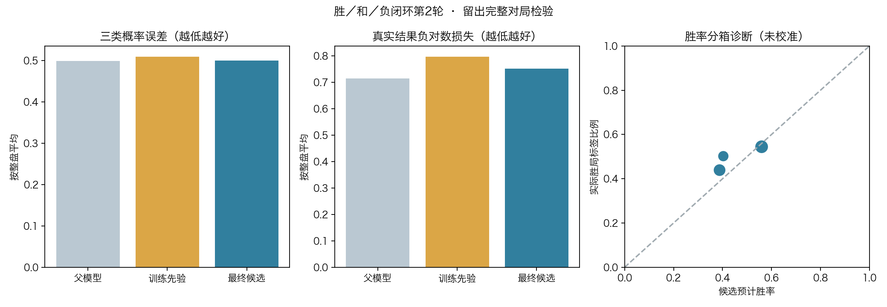
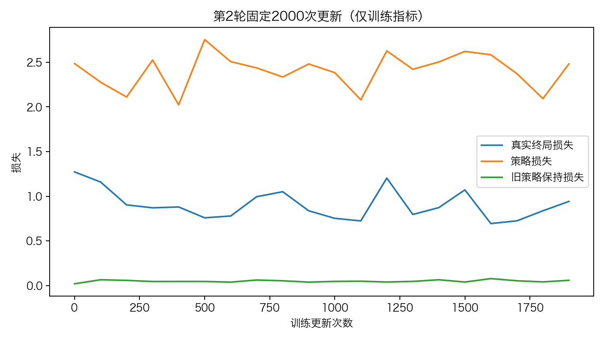

# WDL第二轮续训结果

路线图第3步，2026-11-07。继承首轮候选全部参数，在48盘新自弈上更新2000步，随后完成32盘行为复核。第二轮候选未达到预先设定的开发门槛。界面保留首轮分析模型，棋手使用现役v3。

[执行前协议](protocol.md)固定种子112120、模型父文件与训练预算。零步参数逐值等于父文件。优化器按新一轮重新初始化。策略、CNN和WDL头一起续训，旧标量价值头参数逐值冻结。实际入口耗时558.54秒。

56组开局预先冻结。历史排除310937个轨道。48盘自弈全部真实结束，P1胜27、P2胜19、规则和棋2。训练32盘中P1胜18、P2胜12、和棋2。开发16盘中P1胜9、P2胜7。4379个原始状态中剔除60个历史重复状态，其中2个也属于同一跨组轨道的两边。保留训练2908、开发1411。前缀仅溯源。8组复核开局的输入均与保留的训练样本隔离。

|16盘开发，逐盘等权|父模型|训练玩家先验|第二轮候选|
|---|---:|---:|---:|
|胜负二类Brier|0.248830|0.246750|0.247027|
|胜和负三类Brier|0.498616|0.509338|0.499380|
|真实结果负对数损失|0.715548|0.797887|0.751584|

胜负二类误差比父模型低0.001803，低于预设改善幅度0.005，且略高于训练先验。候选对胜负的条件预测范围扩展至39.27%～60.53%，预测分散本身不能代替准确性。普通策略留出误差从v3的2.397875升至2.487226，增加0.089350，超过0.05容差。两个二类增益检查和普通策略保持检查未通过。开发集无真实和棋，和棋校准缺少验证样本。

|复核对手|候选胜|负|真和|截断|
|---|---:|---:|---:|---:|
|首轮父模型|5|10|1|0|
|现役v3|5|9|2|0|

每对手8根、交换阵营各一局，双方32模拟。以上为小样本诊断。候选及完整训练和搜索工件保存在本机实验目录 nn_checkpoints/experiments/wdl121_loop_round2_20261107。

268项测试通过。独立审计核验56根、48盘自弈4379手、父模型预测、2000步采样轨迹、32盘复核、所有开发门槛和41项执行源码/输入/原生依赖哈希。公开数据是实际路径与概率指标，完整原始搜索日志、模型和训练样本留本机。[独立审计](artifacts/independent_audit.json)

